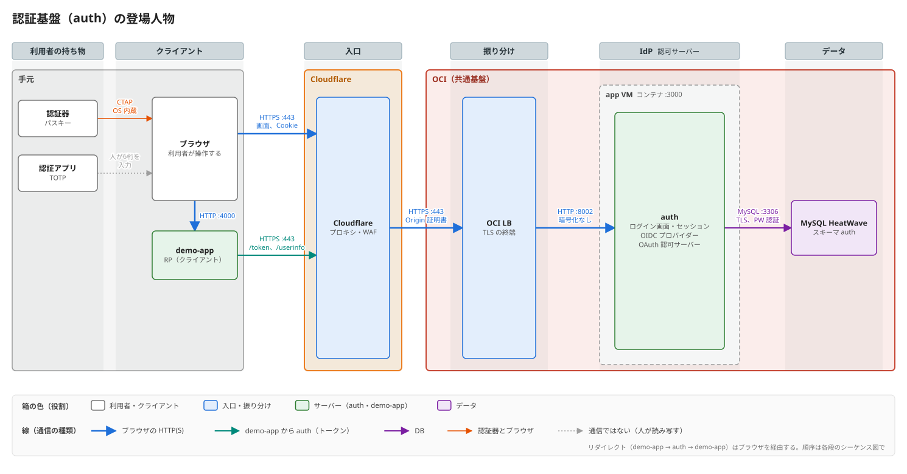

# 設計：認証基盤（auth.alphajinsei.com）

最終更新：2026-11-07

既製品（Keycloak など）を使わずに自作する、認証・認可のサーバー。目的は2つで、認証・認可を一分野として学ぶことと、実際に動くものを持つこと。分野の全体像は [番外編：認証・認可の全体像](notes/extra-auth-overview.md)、進め方は [ロードマップ](roadmap.md)。

## 1. 位置づけ

- OCI の共通基盤（方式③）の Docker ホストに載る、アプリの1つ。共通基盤に足すのは、LB の振り分け1つ（ポート 8002）と、HeatWave のスキーマ1つだけ。共通基盤の仕様は [oci-platform の README](https://github.com/alphajinsei/oci-platform#readme)。置き場所を決めた経緯は [方式検討：OCI](https://github.com/alphajinsei/cf-infra-playbook/blob/main/docs/design/oci.md) の 10。
- 言語とフレームワークは、サンプル（[sample-oci-vm-docker](https://github.com/alphajinsei/sample-oci-vm-docker)）と同じ Node.js + TypeScript + Hono + Drizzle（MySQL）にし、テンプレートからコピーした。ブラウザ側のパスキーは必ず JavaScript になるので、サーバーとデータの形を共有できる。
- 使うのは自分だけ。家族にデモで使ってもらうことはある。

## 2. 作るもの

| 部品 | 置き場所 | 役割 |
| --- | --- | --- |
| IdP（このリポジトリの `src/`） | `auth.alphajinsei.com`（app VM の 8002） | ログイン画面、セッション、OIDC プロバイダー、OAuth の認可サーバー |
| デモのアプリ（demo-app） | 手元（`localhost:4000`）。のちに別のリポジトリ | 「auth でログイン」する側（OIDC の RP）。「auth がログインしてよいと言っているから、うちにもログインさせる」アプリ |

- demo-app は、これから作る個人のサービスが auth でログインするときの**ひな形（認証を受ける側のサンプル）**にする。段4では手元で動かし、形が固まったら sample-oci-vm-docker と同じく独立したリポジトリ（Template repository）にして共通基盤に載せる。名前はそのとき決める。
- OIDC も OAuth も、RP が localhost にあっても成り立つ。
- アクセストークンを受ける API（リソースサーバー）は、まず auth 自身の `/userinfo` で体験する。
- CLI とデバイスコードのフローは作らない。人間が画面でログインして承認する部分はブラウザの流れと同じで、違うのはトークンの受け取り方だけなので、ブラウザの流れを深く理解する方を優先する。
- LDAP は学習だけにとどめ、このリポジトリでは作らない（ロードマップの段6）。

## 3. 画面

画面は2つの側に分かれる。どの方式でログインするかは IdP の中の事情で、アプリからは見えない。

| 側 | 画面 | 段 |
| --- | --- | --- |
| IdP | ログイン（パスワード、または「パスキーでログイン」） | 1・3 |
| IdP | 2要素目（TOTP の6桁） | 2 |
| IdP | アカウント（TOTP の QR、パスキーの登録・削除、ログイン中のセッション） | 2・3 |
| IdP | 同意（「demo-app が、あなたのメモの読み取りを求めています」） | 4 |
| デモのアプリ | トップ（「auth でログイン」のボタン、ログイン後はユーザー名と ID トークンの中身） | 4 |

## 4. 決めたこと

### 利用者

- 利用者（アカウント）の新規登録の画面は、当面作らない。アカウントとパスワードは、サーバーの上で叩く管理用のコマンドで作る（`node dist/admin.js create-user ...`）。誰でも登録できる口がなくなる分、守るものが減る。
- TOTP とパスキーは、手では作れない（パスキーは、ブラウザと認証器が鍵ペアを作る一連の手順で登録する）。ログインしたあと、アカウントの画面から登録する。
- アカウントの回復（パスワードやパスキーを全部なくした）も、当面は管理用のコマンドで行う。

### パスワード

- Argon2id でハッシュにして保存する（ライブラリは `argon2`）。
- ログインの失敗の回数を DB に数え、一定回数を超えたら一時的に止める。

### セッション

- サーバー側のセッション。Cookie には乱数のセッション ID だけを入れ、DB には ID の SHA-256 を置く（DB が漏れても、そのままではセッションに使えない）。
- Cookie は `__Host-session`、`HttpOnly`、`Secure`、`SameSite=Lax`、`Path=/`。ログインのたびに ID を作り直す（セッション固定の対策）。
- 状態を変えるフォームの送信では、`Origin` ヘッダーを確かめる（CSRF の対策。`SameSite=Lax` と二重にする）。

### TOTP

- RFC 6238 の既定（SHA-1、6桁、30秒）。Google Authenticator などの認証アプリで読めることを優先する。
- 6桁を作る計算（HMAC → 切り出し）は自分で書く。QR コードの画像だけライブラリ（`qrcode`）。
- 同じ6桁の再利用を拒む（最後に通った時刻の枠を記録する）。
- 秘密は AES-256-GCM で暗号化して DB に置く。鍵は Terraform で作って Vault に置き、デプロイのときにコンテナの環境変数に渡す（DB のパスワードと同じ経路）。

### 認証の方式を選べるようにする

ID・パスワードだけ、ID・パスワード + TOTP、パスキー、を自由に試せ、人に見せられ、実運用でも選べるようにする。

- 「このアカウントはこの方式に対応」という列は持たない。**アカウント**（`users`）と、**そのアカウントに登録した認証の手段**（パスワードのハッシュ、`totp_credentials`、段3の `webauthn_credentials`）を分け、どの方式でログインできるかは、登録されている手段から決める。
  - パスワードだけ：パスワードでログイン
  - パスワード + 確認済みの TOTP：パスワードのあとに6桁を必ず求める
  - パスキー：パスキーだけでログイン（端末で指紋や PIN を確かめるので、パスキー1つで多要素になる）。パスキーだけのアカウントのために、段3でパスワードを空にできるようにする
- 方式の追加・削除は、利用者がアカウントの画面で行う。
- セッションに、使った方式（`amr`：`pwd`、`pwd otp`、`hwk` など）を記録し、アカウントの画面に「このセッションは何でログインしたか」を出す。段4では同じ値を ID トークンの `amr` に入れ、RP に伝える。RP が「パスキーでログインした人だけ」のように求めるのも、ここから（OIDC の `acr_values`。段4以降）。
- デモ用に、方式ごとのアカウントを管理用のコマンドで作っておく（例：`demo-password`、`demo-totp`、`demo-passkey`）。

### パスキー

- RP ID は `auth.alphajinsei.com`。手元の開発では `localhost`（WebAuthn は localhost を安全な origin として扱う）。
- challenge の発行、origin・RP ID・challenge・フラグの照合、署名の検証は自分で書く。CBOR と authenticator data の分解はライブラリ（`@simplewebauthn/server` の分解用の関数）。
- attestation（認証器の製造元の証明）は求めない（`none`）。個人のサービスでは、どの認証器かを制限する理由がない。

### OIDC と OAuth

- 認可コード + PKCE（S256）だけを受け付ける。インプリシットとパスワードのフローは作らない。
- ID トークンとアクセストークンは JWT（ES256）。リフレッシュトークンは不透明な乱数で、DB に置き、使うたびに取り替える。
- クライアントは管理用のコマンドで登録する（動的な登録は作らない）。`redirect_uri` は完全一致で比べる。
- Discovery（`/.well-known/openid-configuration`）と JWKS（`/jwks.json`）を公開する。

### 前段の構成で気をつけること

- 通信は Cloudflare → OCI LB（ここで TLS が終わる）→ app VM。アプリには HTTP で届く。issuer や Cookie の `Secure` の判断に、リクエストの URL を使わない。issuer は環境変数（`ISSUER=https://auth.alphajinsei.com`）で固定する。

## 5. 要確認

| 項目 | 決める段 |
| --- | --- |
| JWT の署名鍵の置き場所（Terraform で作って Vault に入れる案。DB のパスワードと同じ扱い）と、鍵の入れ替え | 4 |
| demo-app を独立させるときのリポジトリの名前 | 4 のあと |

## 6. 今後の発展

auth を、自分が管理するサービス全体の認証基盤にしていくときに要るもの。今の段には入れない。

- 利用者の新規登録の経路（招待のリンク、メールアドレスの確認）
- アカウントの回復の経路（予備のコード、別の認証器、メール）
- 管理の画面（利用者・クライアントの一覧、無効化）
- ログアウトの連携（OP のセッションを切ったら、RP も切る）

## 7. 検討の経緯

- 2026-11-07：置き場所（共通基盤の Docker ホスト）、自作すること、作る順番（パスワード → TOTP → パスキー → OIDC → デバイスコード → LDAP の学習）を決めた。infra リポジトリから独立させ、このリポジトリを拠点にした。
- 2026-11-07：CLI とデバイスコードのフローをやめ、ブラウザの流れに絞った。demo-app を、今後のサービスのひな形（認証を受ける側のサンプル）として育てることにした。
- 2026-11-12：TOTP の秘密は暗号化して保存（鍵は Vault → 環境変数）。認証の方式は、アカウントの属性ではなく、登録した手段から決める形にした。
