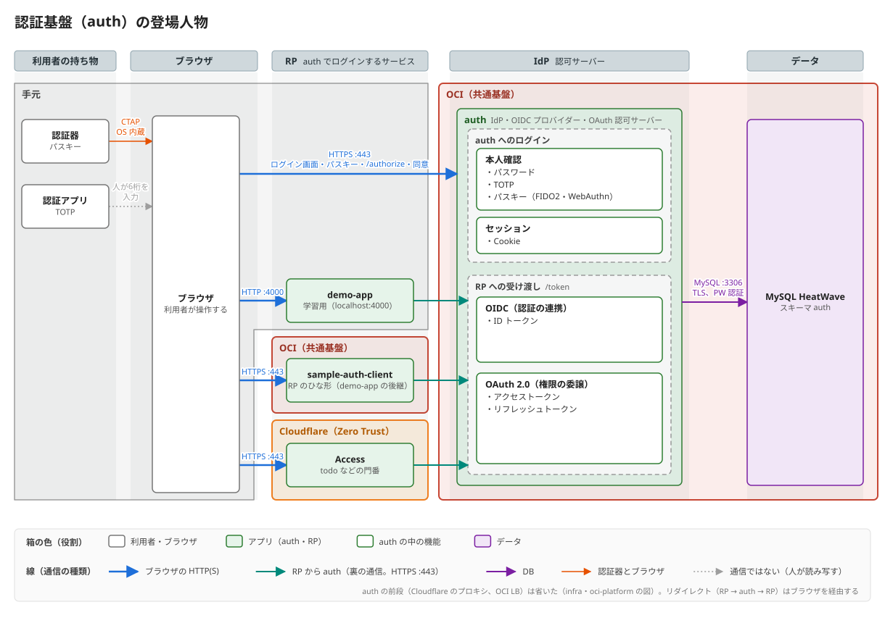

# 設計：認証基盤（auth.alphajinsei.com）

最終更新：2026-11-20

既製品（Keycloak など）を使わずに自作する、認証・認可のサーバー。目的は2つで、認証・認可を一分野として学ぶことと、実際に動くものを持つこと。分野の全体像は [番外編：認証・認可の全体像](notes/extra-auth-overview.md)、進め方は [ロードマップ](roadmap.md)。

## 1. 位置づけ

- OCI の共通基盤（方式③）の Docker ホストに載る、アプリの1つ。共通基盤に足すのは、LB の振り分け1つ（ポート 8002）と、HeatWave のスキーマ1つだけ。共通基盤の仕様は [oci-platform の README](https://github.com/alphajinsei/oci-platform#readme)。置き場所を決めた経緯は [方式検討：OCI](https://github.com/alphajinsei/cf-infra-playbook/blob/main/docs/design/oci.md) の 10。
- 言語とフレームワークは、サンプル（[sample-oci-vm-docker](https://github.com/alphajinsei/sample-oci-vm-docker)）と同じ Node.js + TypeScript + Hono + Drizzle（MySQL）にし、テンプレートからコピーした。ブラウザ側のパスキーは必ず JavaScript になるので、サーバーとデータの形を共有できる。
- 使うのは自分だけ。家族にデモで使ってもらうことはある。

## 2. 作るもの

| 部品 | 置き場所 | 役割 |
| --- | --- | --- |
| IdP（このリポジトリの `src/`） | `auth.alphajinsei.com`（app VM の 8002） | ログイン画面、セッション、OIDC プロバイダー、OAuth の認可サーバー |
| デモのアプリ（demo-app） | 手元（`localhost:4000`）。学習用 | 「auth でログイン」する側（OIDC の RP）。「auth がログインしてよいと言っているから、うちにもログインさせる」アプリ。盗難のまねなど、学ぶための機能も持つ |
| ひな形（[sample-auth-client](https://github.com/alphajinsei/sample-auth-client)） | `sample-auth-client.alphajinsei.com`（app VM の 8003） | demo-app をコンテナにして独立させたもの。今後のサービスが auth でログインするときのひな形 |
| Cloudflare Access（ステップ9） | `alphajinsei.cloudflareaccess.com` | 自分で書いていない RP。todo（`todo.alphajinsei.com/admin`）の前に立つ門番で、ログインの選択肢の1つとして auth を使う。auth の ID トークンを確かめたあと、自分の JWT を出し直して todo に渡す |

- demo-app は、これから作る個人のサービスが auth でログインするときの**ひな形（認証を受ける側のサンプル）**にする。ステップ4では手元で動かし、形が固まったら sample-oci-vm-docker と同じく独立したリポジトリ（Template repository）にして共通基盤に載せる（ステップ6。名前は `sample-auth-client`）。学ぶための機能（盗難のまね）は持っていかず、demo-app はこのリポジトリに学習用として残す。
- OIDC も OAuth も、RP が localhost にあっても成り立つ。
- アクセストークンを受ける API（リソースサーバー）は、まず auth 自身の `/userinfo` で体験する。
- CLI とデバイスコードのフローは作らない。人間が画面でログインして承認する部分はブラウザの流れと同じで、違うのはトークンの受け取り方だけなので、ブラウザの流れを深く理解する方を優先する。
- LDAP は学習だけにとどめ、このリポジトリでは作らない（ロードマップのステップ8）。のちに学習もやめた。

### 登録している client（呼び出し元の台帳）

auth に `admin create-client` で登録している RP。呼び出し元が増えたら、ここに1行足す（oci-platform の README のポートの台帳と同じ考え方）。client を変えたり消したりするときに、どこに影響するかをここで見る。secret の値は書かない。

| client_id | 何か | 置き場所 | redirect_uri | scope | client の認証 | secret の置き場所 | 使うクレーム | ステップ |
| --- | --- | --- | --- | --- | --- | --- | --- | --- |
| `demo-app` | 学習用の RP | 手元（このリポジトリの `demo-app/`） | `http://localhost:4000/callback` | `openid profile` | `client_secret_basic` | 手元の `demo-app/.env`（git 管理外） | `sub`、`preferred_username`、`amr` | 4〜5 |
| `sample-auth-client` | RP のひな形 | `sample-auth-client.alphajinsei.com` | `https://sample-auth-client.alphajinsei.com/callback` | `openid profile` | `client_secret_basic` | sample-auth-client の Terraform が作り、Vault | `sub`、`preferred_username`、`amr` | 6 |
| `cloudflare-access` | todo を守る Cloudflare Access | `alphajinsei.cloudflareaccess.com` | `https://alphajinsei.cloudflareaccess.com/cdn-cgi/access/callback` | `openid email profile` | 未確定（9-b で監査ログから確かめる） | todo の Terraform が作り、Access の IdP の設定と state（R2） | `email`（Access のポリシーと照らす） | 9（作業中） |

- `cloudflare-access` は Cloudflare のアカウントに1つの IdP の設定なので、todo 以外の Access のアプリ（hoikuen など）からも選べるようになる。使うアプリが増えたら、ここの「何か」を直す。

## 3. 画面

画面は2つの側に分かれる。どの方式でログインするかは IdP の中の事情で、アプリからは見えない。

| 側 | 画面 | ステップ |
| --- | --- | --- |
| IdP | ログイン（パスワード、または「パスキーでログイン」） | 1・3 |
| IdP | 2要素目（TOTP の6桁） | 2 |
| IdP | アカウント（TOTP の QR、パスキーの登録・削除、ログイン中のセッション） | 2・3 |
| IdP | 同意（「demo-app が、あなたのメモの読み取りを求めています」） | 4 |
| デモのアプリ | トップ（「auth でログイン」のボタン、ログイン後はユーザー名と ID トークンの中身） | 4 |

## 4. 決めたこと

### 利用者

- 利用者（アカウント）の新規登録の画面は、当面作らない。アカウントとパスワードは、サーバーの上で叩く管理用のコマンドで作る（`node dist/admin.js create-user ...`）。誰でも登録できる口がなくなる分、守るものが減る。パスキーだけのアカウントは、パスワードでログインしてパスキーを登録したあと、自分でパスワードを削除して作る（ステップ3-c）。端末を全部なくしたときは、管理者が `set-password` で設定し直す。
- TOTP とパスキーは、手では作れない（パスキーは、ブラウザと認証器が鍵ペアを作る一連の手順で登録する）。ログインしたあと、アカウントの画面から登録する。
- アカウントの回復（パスワードやパスキーを全部なくした）も、当面は管理用のコマンドで行う。

### パスワード

- Argon2id でハッシュにして保存する（ライブラリは `argon2`）。
- ログインの失敗の回数を DB に数え、一定回数を超えたら一時的に止める。

### セッション

- サーバー側のセッション。Cookie には乱数のセッション ID だけを入れ、DB には ID の SHA-256 を置く（DB が漏れても、そのままではセッションに使えない）。
- Cookie は `__Host-session`、`HttpOnly`、`Secure`、`SameSite=Lax`、`Path=/`。ログインのたびに ID を作り直す（セッション固定の対策）。
- 状態を変えるフォームの送信では、`Origin` ヘッダーを確かめる（CSRF の対策。`SameSite=Lax` と二重にする）。

### TOTP

- RFC 6238 の既定（SHA-1、6桁、30秒）。Google Authenticator などの認証アプリで読めることを優先する。
- 6桁を作る計算（HMAC → 切り出し）は自分で書く。QR コードの画像だけライブラリ（`qrcode`）。
- 同じ6桁の再利用を拒む（最後に通った時刻の枠を記録する）。
- 秘密は AES-256-GCM で暗号化して DB に置く。鍵は Terraform で作って Vault に置き、デプロイのときにコンテナの環境変数に渡す（DB のパスワードと同じ経路）。

### 認証の方式を選べるようにする

ID・パスワードだけ、ID・パスワード + TOTP、パスキー、を自由に試せ、人に見せられ、実運用でも選べるようにする。

- 「このアカウントはこの方式に対応」という列は持たない。**アカウント**（`users`）と、**そのアカウントに登録した認証の手段**（パスワードのハッシュ、`totp_credentials`、ステップ3の `webauthn_credentials`）を分け、どの方式でログインできるかは、登録されている手段から決める。
  - パスワードだけ：パスワードでログイン
  - パスワード + 確認済みの TOTP：パスワードのあとに6桁を必ず求める
  - パスキー：パスキーだけでログイン（端末で指紋や PIN を確かめるので、パスキー1つで多要素になる）。パスキーだけのアカウントのために、ステップ3でパスワードを空にできるようにする
- 方式の追加・削除は、利用者がアカウントの画面で行う。
- セッションに、使った方式（`amr`：`pwd`、`pwd otp`、`hwk` など）を記録し、アカウントの画面に「このセッションは何でログインしたか」を出す。ステップ4では同じ値を ID トークンの `amr` に入れ、RP に伝える。RP が「パスキーでログインした人だけ」のように求めるのも、ここから（OIDC の `acr_values`。ステップ4以降）。
- デモ用に、方式ごとのアカウントを管理用のコマンドで作っておく（例：`demo-password`、`demo-totp`、`demo-passkey`）。

### パスキー

- RP ID は `auth.alphajinsei.com`。手元の開発では `localhost`（WebAuthn は localhost を安全な origin として扱う）。
- challenge の発行、origin・RP ID・challenge・フラグの照合、署名の検証は自分で書く。CBOR と authenticator data の分解はライブラリ（`@simplewebauthn/server` の分解用の関数）。
- attestation（認証器の製造元の証明）は求めない（`none`）。個人のサービスでは、どの認証器かを制限する理由がない。

### OIDC と OAuth

- 認可コード + PKCE（S256）だけを受け付ける。インプリシットとパスワードのフローは作らない。
- ID トークンとアクセストークンは JWT（ES256）。リフレッシュトークンは不透明な乱数で、DB に置き、使うたびに取り替える。
- クライアントは管理用のコマンドで登録する（動的な登録は作らない）。`redirect_uri` は完全一致で比べる。
- Discovery（`/.well-known/openid-configuration`）と JWKS（`/jwks.json`）を公開する。
- client の認証は、`client_secret_basic`（Authorization ヘッダー）と `client_secret_post`（本文）の2つを受ける。1つの要求で両方を使ってきたら断る（RFC 6749 2.3）。`client_secret_post` は、どちらで送ってくるか分からない Access のために足した（ステップ9）。

### email

利用者のメールアドレスを、auth の DB に持ち、RP に渡せるようにする（ステップ9）。Access が、ID トークンのメールアドレスで利用者を見分け、ポリシー（「このアドレスなら通す」）と照らすため。

- **持ち方（DB）**：利用者の表（`users`）に、メールアドレスの列 `email` を足す。空でもよく、同じアドレスを2人に入れることはできない（RP がアドレスで利用者を見分けるので、重なると取り違える）。
- **入れ方**：管理用のコマンド（`admin set-email <username> <email>`）だけ。利用者が画面から書く口はない。
- **RP への渡し方**：RP が `/authorize` で `email` scope を求めたときだけ、ID トークンと `/userinfo` の返事に、次の2つのクレーム（OIDC の標準の項目）を足す（OIDC Core 5.4）。アドレスが空の利用者には、どちらも足さない。`email` scope を求めない RP（demo-app、sample-auth-client）には、これまでどおり出さない。

  | クレーム | 値 | 意味 |
  | --- | --- | --- |
  | `email` | DB の `email` の値 | 利用者のメールアドレス |
  | `email_verified` | 常に `true` | 「このアドレスが本人のものだと、auth が確かめた」という auth の宣言 |

- **`email_verified` を `true` にする理由**：アドレスを入れるのは管理者（自分）だけで、本人のものだと分かっているため。利用者が自分でアドレスを書けるようにするなら（「6. 今後の発展」の新規登録）、確認のメールが済むまでは `false` にする。確かめていないアドレスを `true` で出すと、アドレスで利用者を見分ける RP（Access など）に、他人のアドレスを書いた人がその人として入れてしまう。

### 自分で書いていない RP（ステップ9）

- 登録のしかたは、自分の RP と同じ（`admin create-client --secret-stdin`）。client_secret は RP の側の Terraform が作る。Access の場合は todo の Terraform が作って Access の IdP の設定に入れ、auth へは ssh で流し込む（Vault は経由しない。todo の Terraform は Cloudflare だけを扱うため）。
- 相手の求めることは、ドキュメントで分かる範囲で合わせ、分からないこと（client の認証の方式など）は両方を受けて、監査ログで実際を確かめる。
- 詳しくは [ステップ9の設計](steps/9-cloudflare-access.md)。

### OIDC の OP として、足りていないもの

ステップ4・5で作ったもの（認可コード + PKCE、同意、ID トークン、Discovery、JWKS、`/userinfo`、JWT のアクセストークン、リフレッシュトークンの取り替えと盗難の検知、`/revoke`）で、**自分のサービスのログインを1か所にまとめる**には足りる。ただし、OIDC の OP として仕様どおりに名乗るには足りないものがあり、製品並みにするなら、さらに拡張がある。分かっていて作っていないもの：

| 段 | 項目 | 今の auth |
| --- | --- | --- |
| 仕様が全 OP に求める（OIDC Core 15.1） | ID トークンの RS256 での署名 | ES256 だけ |
| | `prompt`（`none`、`login`、`consent`）、`max_age` | 受け取らない（auth_time は入れている） |
| | `display`、`ui_locales`、`acr_values` | 受け取らない（多くは「できる範囲で従う」でよい） |
| 運用で欲しくなる | ログアウトの連携（RP-Initiated Logout、Back-Channel Logout） | demo-app からログアウトしても、auth のセッションは残る |
| | 署名の鍵の入れ替え（JWKS に新旧を並べる） | 鍵は1つ。作り直すと、出した ID トークンが検証できなくなる |
| | 同意の管理画面、client の管理（secret の作り直し、redirect_uri の追加） | 管理用のコマンドで登録するだけ |
| | public client（secret を持てない SPA、スマホのアプリ） | confidential client（client_secret あり）だけ |
| | secret を送らない client の認証（`private_key_jwt`、`client_secret_jwt`、mTLS） | `client_secret_basic` と `client_secret_post`（secret そのものを TLS の上で送る）だけ |
| | `/token` の回数の制限、盗難の検知の通知 | 監査ログに出すだけ |
| 用途によって足す | client_credentials、デバイスの流れ（RFC 8628）、Introspection（RFC 7662）、動的な登録（RFC 7591）、PAR（RFC 9126）、DPoP（RFC 9449）・mTLS、ペアワイズの sub | 作らない |

- どこまで仕様に合っているかは、OpenID Foundation の適合性のテスト（conformance suite。たとえば「Basic OP」）で確かめられる。上の表の1段目が、そのまま失敗として出るはず。
- 足すなら、実用の面ではログアウトの連携と鍵の入れ替えが先（「6. 今後の発展」）。
- 経緯：[勉強メモ](notes/study-notes.md) の「OAuth・OIDC のサーバーを実装するといった場合、ステップ4・ステップ5の内容を網羅して完成か」。

### 前段の構成で気をつけること

- 通信は Cloudflare → OCI LB（ここで TLS が終わる）→ app VM。アプリには HTTP で届く。issuer や Cookie の `Secure` の判断に、リクエストの URL を使わない。issuer は環境変数（`ISSUER=https://auth.alphajinsei.com`）で固定する。

## 5. 要確認

| 項目 | 決めるステップ |
| --- | --- |
| JWT の署名鍵の置き場所（Terraform で作って Vault に入れる案。DB のパスワードと同じ扱い）と、鍵の入れ替え | 4 |

## 6. 今後の発展

auth を、自分が管理するサービス全体の認証基盤にしていくときに要るもの。今のステップには入れない。

- 利用者の新規登録の経路（招待のリンク、メールアドレスの確認）
- アカウントの回復の経路（予備のコード、別の認証器、メール）
- 管理の画面（利用者・クライアントの一覧、無効化）
- ログアウトの連携（OP のセッションを切ったら、RP も切る）
- 署名の鍵の入れ替え、`prompt`・`max_age` など、OIDC の OP として足りていないもの（「4. 決めたこと」の「OIDC の OP として、足りていないもの」）

## 7. 検討の経緯

- 2026-11-07：置き場所（共通基盤の Docker ホスト）、自作すること、作る順番（パスワード → TOTP → パスキー → OIDC → デバイスコード → LDAP の学習）を決めた。infra リポジトリから独立させ、このリポジトリを拠点にした。
- 2026-11-07：CLI とデバイスコードのフローをやめ、ブラウザの流れに絞った。demo-app を、今後のサービスのひな形（認証を受ける側のサンプル）として育てることにした。
- 2026-11-12：TOTP の秘密は暗号化して保存（鍵は Vault → 環境変数）。認証の方式は、アカウントの属性ではなく、登録した手段から決める形にした。
- 2026-11-19：demo-app を `sample-auth-client` として独立させることにした。名前は、基盤（OCI、コンテナ）ではなく「auth を呼ぶ側」という役割で付けた。セッションは DB に置く（デプロイで切れないように）。client_secret は client の Terraform が作って Vault に置き、`admin create-client --secret-stdin` で auth に流し込む。auth への通信は公開の URL（Cloudflare の上のアプリと同じ道）。LDAP はやめ、これを最後のステップにした。
- 2026-11-19：認可（アクセス制御）をステップ7として足した。RBAC で実務は足りるが、判断をモジュール（PDP）として切り出す作りを見るために、関係のタプルで答える PDP を小さく作る。
- 2026-11-19：認可は実装しないことにした（来歴だけ）。メモを作ると、認証の話から論点がずれるため。
- 2026-11-20：todo を守る Cloudflare Access に「auth でログイン」を足すことにした（ステップ9）。そのために、email（`users.email`、`email` scope、`email_verified`）と `client_secret_post` を足す。本番に関わるコマンド（デプロイ、apply、client の登録）は、ユーザーが実行する。
