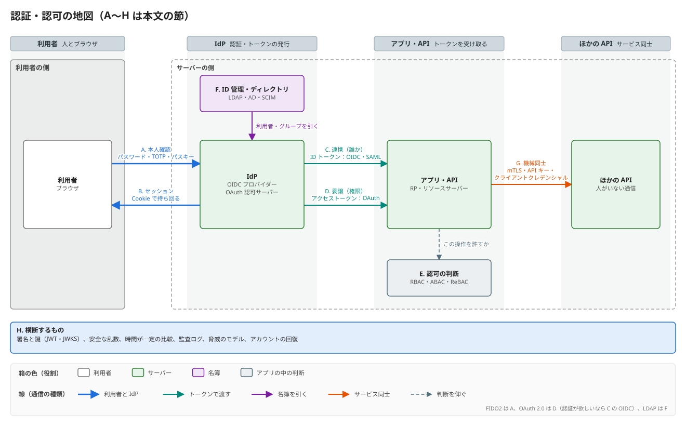

# 番外編：認証・認可の全体像

最終更新：2026-11-07

認証基盤（`auth.alphajinsei.com`、方式③の Docker ホストに載せる自作のアプリ）を作り始める前に、認証・認可という分野の地図を作る。どんな小分野に分かれ、それぞれの主要な技術とよく使われる方式は何か。このリポジトリで作るものは [設計](../design.md)、進め方は [ロードマップ](../roadmap.md)。

## 1. 3つの問い

認証・認可と呼ばれるものは、突き詰めると次の3つの問いに分かれる。混ざって語られることが多いので、最初に分けておく。

| 問い | 名前 | 例 | 間違えたときに起きること |
| --- | --- | --- | --- |
| あなたは誰か | 認証（Authentication、AuthN） | パスワード、パスキー、「Google でログイン」 | なりすまし |
| あなたは何をしてよいか | 認可（Authorization、AuthZ） | 「管理者だけが削除できる」「このアプリに Google カレンダーの読み取りだけ許す」 | 権限の昇格、情報の漏洩 |
| 誰がいるのか | ID 管理（Identity Management） | 社員の名簿、グループ、退職者の無効化 | 消し忘れたアカウント、誰も把握していない権限 |

もう1つ、認証の結果を**覚えておく**仕組み（セッション）がある。毎回のリクエストでパスキーを求めるわけにはいかないので、「さっき認証した人だ」という証明を持ち回る。実際の事故は、認証そのものより、このセッションや後で出てくるトークンの扱いで起きることが多い。

## 2. 地図



OAuth・OIDC の用語（IdP、RP、トークンの種類など）は [番外編：OAuth・OIDC の用語](extra-auth-terms.md)。

以下、A〜H の順に見る。

## 3. A. 本人確認（認証の要素）

「本人だけが出せるもの」を出させる。出せるものは昔から3種類に分けられる。

| 要素 | 意味 | 技術 |
| --- | --- | --- |
| 知識 | 知っているもの | パスワード、PIN、秘密の質問（今は非推奨） |
| 所持 | 持っているもの | TOTP のアプリ、SMS・メールのコード、セキュリティキー、パスキーが入ったスマホ |
| 生体 | 本人そのもの | 指紋、顔。ただし WebAuthn では生体情報はサーバーに送られず、端末の中の鍵を使うための「鍵の鍵」でしかない |

違う種類を2つ以上組み合わせるのが多要素認証（MFA）。パスワードを2つ聞いても MFA にはならない。

### パスワード

- サーバーは平文も、ただのハッシュ（SHA-256 など）も持たない。**わざと遅く、メモリを食う**ハッシュ関数で、ユーザーごとのソルトを付けて保存する。今の推奨は Argon2id、次が bcrypt・scrypt。Dovecot の `SHA512-CRYPT` は、反復回数を増やして遅くした古い方式（crypt）。
- 現在の考え方（NIST SP 800-63B）は「長さを求め、文字種の強制と定期変更はやめ、漏洩済みパスワードの一覧と照合する」。
- 攻撃の主流は、他所で漏れた ID とパスワードの組を試すリスト型攻撃（credential stuffing）。対策は、回数制限と MFA。

### ワンタイムパスワード（OTP）

- **TOTP**（RFC 6238）：サーバーと端末で共有した秘密鍵と、現在時刻（30秒単位）から HMAC で6桁を作る。HOTP（RFC 4226）の回数のカウンタを時刻に替えたもの。Google Authenticator などの QR コードは、この秘密鍵を `otpauth://` の URL にしたもの。
- **SMS・メールのコード**、**マジックリンク**（メールのリンクを踏むとログイン）は「そのメールアドレス・電話番号を持っている」ことを所持として使う。
- 共通の弱点は**フィッシングに弱い**こと。偽サイトに6桁を入力させれば、攻撃者はそれを30秒以内に本物のサイトへ中継できる（リアルタイムのフィッシング）。

### FIDO2（WebAuthn + CTAP）とパスキー

| 名前 | 何か |
| --- | --- |
| FIDO2 | FIDO Alliance と W3C による規格群の総称。下の2つから成る |
| WebAuthn | ブラウザの JavaScript API（`navigator.credentials.create()` / `.get()`）と、サーバーとのやりとりの形を決めた W3C の規格 |
| CTAP | ブラウザ（OS）と認証器（セキュリティキー、スマホ）の間の通信規格。USB・NFC・BLE |
| パスキー | WebAuthn の資格情報のうち、ユーザー名を入れなくても選べる（discoverable）ものの通称。多くは端末の間で同期される（iCloud キーチェーン、Google パスワードマネージャー） |

仕組みは公開鍵暗号の署名そのもの。

```
Registration
  server --challenge (random), rp.id = "auth.example.com"--> browser --> authenticator
  authenticator: create a new key pair just for this site
  authenticator --public key, credential id (+ attestation)--> server stores them

Login
  server --challenge (random)--> browser --> authenticator
  authenticator: sign (challenge + origin seen by the browser + counter) with the private key
  server: verify the signature with the stored public key, check origin and challenge
```

- サーバーに残るのは公開鍵だけ。漏れても、それでログインはできない。パスワードと違い、サーバーが「秘密」を持たない。
- **フィッシングに強い理由**：署名の対象に、ブラウザが見ている本当の origin が入る。そもそも認証器は、サイト（RP ID）ごとに別の鍵を持ち、偽サイトのドメインには本物の鍵を使わない。人間が見分けなくても、仕組みが見分ける。OTP との本質的な違いはここ。
- 鍵ペアはサイトごとに別なので、サイトをまたいで同一人物だと追跡できない。
- 端末の中で指紋や PIN を確かめる（user verification）ので、パスキー1つで「所持 + 生体（か知識）」の MFA になる。
- サーバー側の実装で扱うもの：CBOR（バイナリの JSON のようなもの）で符号化された attestation object、COSE 形式の公開鍵、authenticator data のバイト列の解釈、署名の検証（ES256 が主、RS256・EdDSA も）。

### 保証の強さ

NIST SP 800-63B は認証の強さを AAL1〜3 に分けている。大まかには、AAL1 がパスワードだけ、AAL2 が MFA、AAL3 がフィッシング耐性があって鍵を取り出せないハードウェア（セキュリティキーなど）。

### 見落とされがちなもの：アカウントの回復

パスキーをなくした、パスワードを忘れた、のときの経路が一番弱い入口になる。「パスキー必須だが、回復はメールのリンクで」なら、強さはメールと同じになる。回復をどうするかは、認証の方式を決めるときに一緒に決める。

## 4. B. セッション管理

認証が済んだことを、以後のリクエストで示す仕組み。

| 方式 | 何を持ち回るか | 失効 | 向いているもの |
| --- | --- | --- | --- |
| サーバー側のセッション | ランダムなセッション ID だけを Cookie に入れ、中身はサーバーの DB に置く | DB の行を消せば即座に失効 | ブラウザで使う Web アプリ。最も堅い既定 |
| 自己完結のトークン | ユーザー ID や期限を書いて署名したもの（JWT など）を持たせ、サーバーは署名を検証するだけ | 期限まで止められない（止めるには結局、失効の一覧を引く） | 複数のサーバーや API に配る。D の OAuth のアクセストークン |

- Cookie の属性：`HttpOnly`（JavaScript から読めない。XSS で盗まれにくい）、`Secure`（HTTPS のときだけ送る）、`SameSite=Lax/Strict`（よそのサイトからのリクエストに付けない。CSRF の対策）、`__Host-` の接頭辞（ドメイン属性を禁じ、そのホストだけに限る）。
- 主な攻撃：XSS によるトークンの窃取、CSRF（ログイン中のユーザーに、よそのサイトから操作させる）、セッション固定（攻撃者が用意した ID でログインさせる。対策はログイン時に ID を作り直す）。
- 「JWT を Cookie の代わりにブラウザの localStorage に入れる」構成はよく見るが、XSS で読まれ、失効もできない。ブラウザ向けには Cookie のセッションが基本。

## 5. C. 連携（フェデレーション・SSO）

ユーザーの認証を、アプリ自身ではなく、別の専門のサーバー（IdP）に任せる。アプリ（RP / SP）は「IdP が、この人は alice だと署名付きで言っている」ことを信じる。アプリごとにパスワードを持たなくてよくなり、1回のログインで複数のアプリに入れる（SSO）。

| 規格 | 年代 | 形式 | よく使われる場所 |
| --- | --- | --- | --- |
| SAML 2.0 | 2005〜 | XML の署名付きアサーション。ブラウザのリダイレクトと POST で運ぶ | 企業の SaaS 連携（Entra ID・Okta から Salesforce、AWS コンソールなど） |
| OpenID Connect（OIDC） | 2014〜 | OAuth 2.0 の上に「ID トークン」（JWT）を足したもの | 「Google でログイン」、新しく作るものの既定。Cloudflare Access、OCI IAM も話せる |
| Kerberos | 1980年代〜 | 対称鍵のチケット | 社内ネットワーク（Active Directory のドメイン参加、Windows の統合認証） |

新しく作るなら OIDC 一択に近い。SAML は企業の既存資産との接続で今も現役。

OIDC で RP が IdP について知る必要があることは、`https://<IdP>/.well-known/openid-configuration`（Discovery）にまとまっている。各エンドポイントの URL と、署名の検証に使う公開鍵の置き場所（`jwks_uri`）。RP は ID トークンの署名・`iss`（発行者）・`aud`（自分宛てか）・`exp`（期限）・`nonce`（使い回しでないか）を確かめる。

## 6. D. 委譲された認可（OAuth 2.0）

OAuth 2.0（RFC 6749）は「ユーザーのパスワードを渡さずに、あるアプリ（クライアント）に、ユーザーの持つ資源への限られた権限を渡す」ための枠組み。もとの動機は「写真の印刷サービスに Google フォトを読ませたいが、Google のパスワードは渡したくない」。

### 登場人物

| 役割 | 意味 | 例 |
| --- | --- | --- |
| リソースオーナー | 資源の持ち主。たいていユーザー | alice |
| クライアント | 資源を使いたいアプリ | 印刷サービス、自分の SPA |
| 認可サーバー（AS） | ユーザーの同意を取り、トークンを発行する | `auth.alphajinsei.com` |
| リソースサーバー（RS） | 資源を持ち、トークンを見て応じる API | メモ帳の API |

### よく使われるフロー（grant）

| フロー | 使う場面 | 今の扱い |
| --- | --- | --- |
| 認可コード + PKCE | ユーザーがいるもの全部（Web、SPA、スマホ、CLI） | 標準。OAuth 2.1 では PKCE が必須 |
| クライアントクレデンシャル | ユーザーがいない、機械同士（バッチ、サービス間） | 標準 |
| デバイスコード（RFC 8628） | 入力しにくい端末（テレビ、CLI）。別の端末でコードを入れて承認 | `gh auth login` がこれ |
| リフレッシュトークン | アクセストークンを短命にし、更新に使う | 標準。使うたびに取り替える（rotation） |
| インプリシット | かつての SPA 向け。トークンを URL で返す | 廃止 |
| パスワード（ROPC） | クライアントがパスワードを直接受け取る | 廃止。OAuth の目的に反する |

認可コード + PKCE の流れ：

```
client --redirect: /authorize?client_id&redirect_uri&scope&state&code_challenge--> AS
AS: user logs in (A) and consents
AS --redirect: redirect_uri?code&state--> client
client --POST /token: code + code_verifier (+ client secret)--> AS
AS --access token (+ refresh token, + ID token if OIDC)--> client
client --Authorization: Bearer <access token>--> RS
```

- `code_challenge` は、クライアントが作った乱数（`code_verifier`）のハッシュ。途中でコードを盗まれても、乱数を知らないと交換できない。
- `state` は、自分が始めたフローの戻りかを確かめる値（CSRF の対策）。
- `redirect_uri` は登録済みのものと完全一致で比べる。ここを緩くすると、コードが攻撃者のサイトに届く（OAuth の事故の典型）。
- `scope` で権限の範囲を決める（`memos:read` など）。

### OAuth は認証ではない

OAuth のアクセストークンは「このクライアントに、この権限を渡した」という証明で、「今ログインしているのは誰か」をクライアントに伝えるためのものではない。これを認証に流用して事故が多発したので、認証の部分を正式に足したのが OIDC（C）。**認証が欲しいなら OIDC、API の権限を渡したいなら OAuth**。実際には同じサーバーが両方を兼ね、1回のフローで ID トークンとアクセストークンを同時に出すことが多い。

### アクセストークンの形と検証

- 不透明な乱数にして、RS が AS に問い合わせる（イントロスペクション、RFC 7662）か、JWT にして RS が署名を検証する（RFC 9068）か。後者は AS に問い合わせなくて速いが、期限まで失効できない（B と同じ話）ので、寿命を5〜15分程度に短くする。
- Bearer トークンは「持っている人が使える」。盗まれたら使われる。持ち主の鍵に縛る方式として DPoP（RFC 9449）と mTLS（RFC 8705）がある。
- 失効（RFC 7009）、認可サーバーのメタデータ（RFC 8414）、クライアントの動的な登録（RFC 7591）も周辺の規格。
- OAuth 2.1 は、これらの十数年分の追補とベストプラクティス（RFC 9700）を1つにまとめ直している最中の版。

## 7. E. 認可のモデル（アプリの中のアクセス制御）

トークンで「誰か」と「大まかな権限（scope）」が分かったあと、「この人がこのメモを消してよいか」を決めるのはアプリ側の仕事。OAuth の scope は「クライアントに何を許したか」で、「ユーザーが何を持っているか」とは別の軸。

| モデル | 考え方 | 例 | 向き不向き |
| --- | --- | --- | --- |
| ACL | 資源ごとに、誰が何をできるかの一覧を持つ | ファイルのパーミッション、S3 のバケットポリシー | 単純。人や資源が増えると管理できない |
| RBAC | 人に役割（ロール）を、役割に権限を割り当てる | admin / editor / viewer | 業務システムの主流。「自分のメモだけ」のような条件が苦手 |
| ABAC | 人・資源・環境の属性で条件式を書く | 「部署が同じで、勤務時間内なら」 | 柔軟。ポリシーが読めなくなりやすい |
| ReBAC | 人と資源の関係（グラフ）から辿る | 「フォルダの編集者は、中の文書も編集できる」。Google Drive の共有 | Google の Zanzibar（2019）が元。OpenFGA、SpiceDB |

判断する場所（PDP：Policy Decision Point）と、実際に止める場所（PEP：Enforcement Point）を分ける考え方があり、ポリシーをコードから切り出すエンジンとして OPA（Rego）、AWS の Cedar がある。個人のサービスでは、RBAC と「持ち主だけ」の条件をアプリのコードに書けば十分なことが多い。

## 8. F. ID 管理とディレクトリ（LDAP）

「誰がいて、どのグループに属しているか」を、多くのシステムから引ける場所に1つ置く。

### LDAP

LDAP（Lightweight Directory Access Protocol、RFC 4511 ほか）は、ディレクトリ（木構造の名簿）を読み書きするためのプロトコル。X.500 という重い規格の軽量版として1990年代に作られた。

```
dc=alphajinsei,dc=com
 +-- ou=people
 |    +-- uid=alice      objectClass: inetOrgPerson
 |    |                  cn: Alice, mail: alice@..., userPassword: {ARGON2}...
 |    +-- uid=bob
 +-- ou=groups
      +-- cn=admins      member: uid=alice,ou=people,dc=alphajinsei,dc=com
```

- 各エントリは DN（Distinguished Name、木の根からのパス。`uid=alice,ou=people,dc=alphajinsei,dc=com`）で指す。属性の種類は schema（objectClass）で決まる。
- 主な操作は bind（認証。DN とパスワードで名乗る）、search（起点・範囲・フィルタ `(&(objectClass=person)(mail=alice@*))` で探す）、add / modify / delete。
- 通信は ASN.1 を BER で符号化したバイナリ。ポートは 389（StartTLS）と 636（LDAPS）。
- **LDAP は名簿であり、それ自体は Web のログインの仕組みではない。**認証に使うときは「bind が通ればパスワードが正しい」を利用する。Linux のログイン（SSSD）、メールサーバー（Dovecot・Postfix）、VPN、ネットワーク機器、Jenkins などの古くからあるソフトは、たいてい LDAP で利用者を引ける。
- 代表的な実装は OpenLDAP、389 Directory Server。**Active Directory** は LDAP + Kerberos + DNS を1つにした Microsoft のディレクトリで、企業の ID の実質的な起点。

### 企業での典型的な流れ

```
HR system --> AD / LDAP (source of truth) --> IdP (Entra ID, Okta, Keycloak) --SAML/OIDC--> SaaS apps
                                                    |
                                                    +--SCIM--> SaaS apps (create / disable accounts)
```

- **SCIM**（RFC 7643・7644）は、ユーザーとグループを REST + JSON で他のシステムに作る・止めるための規格（プロビジョニング）。SSO は「ログインのとき」の話で、SCIM は「入社・異動・退職のとき」の話。
- 新しい IdP（Keycloak など）は、内部の DB に利用者を持ちつつ、既存の LDAP / AD を読みに行く（User Federation）こともできる。

## 9. G. 機械同士の認証

ユーザーがいない通信。

| 方式 | 中身 | 例 |
| --- | --- | --- |
| API キー | 長い乱数を共有する。実質パスワード | 多くの SaaS の API、Cloudflare の API トークン |
| HMAC の署名 | 共有鍵でリクエストの中身と時刻に署名する。鍵そのものは送らない | AWS の Signature V4、Webhook の署名 |
| OAuth クライアントクレデンシャル | client_id と secret（か秘密鍵で署名した JWT）でアクセストークンをもらう | サービス間の API |
| mTLS | クライアントも証明書を出す TLS | 社内のサービス間、銀行の API |
| ワークロード ID | 実行基盤が「このプロセスは何か」を証明し、短命の資格情報を配る | OCI のインスタンス・プリンシパル、AWS の IAM ロール、GitHub Actions の OIDC、SPIFFE |

流れは「長命の共有鍵」から「基盤が証明する短命の資格情報」へ。

## 10. H. 横断するもの

- **署名と鍵**：JWT は JWS（RFC 7515）の一形態で、`header.payload.signature` を base64url でつないだもの。公開鍵は JWK（RFC 7517）の形で JWKS として公開し、`kid` で選ぶ。鍵を替える（ローテーション）ときは、新旧を一時的に両方載せる。`alg: none` や、RS256 の公開鍵を HS256 の共有鍵として扱わせる攻撃など、検証の側の実装の誤りが典型的な脆弱性。**検証側で受け付ける alg を固定する**。
- **乱数**：セッション ID、challenge、code、state は暗号論的に安全な乱数で作る（Node.js なら `crypto.randomBytes`）。
- **比較**：秘密の比較は時間が一定の関数で行う（`crypto.timingSafeEqual`）。
- **監査ログ**：誰がいつ、どこからログインし、何に失敗したか。不正の発見と、自分の実装の検証の両方に使う。
- **脅威のモデル**：フィッシング、リスト型攻撃、トークンの漏洩、リダイレクトの悪用、アカウントの回復の悪用。どの対策がどれに効くかを対応付けておく。

## 11. よく使われる組み合わせ

| 場面 | 構成 |
| --- | --- |
| 小さな Web サービス | パスワード（Argon2id）+ TOTP か、パスキー。Cookie のサーバー側セッション。認可はアプリのコードで RBAC |
| 消費者向けサービス | 「Google / Apple でログイン」（OIDC の RP になる）+ パスキー。自前のパスワードは減らす方向 |
| SPA + API | 認可コード + PKCE。ブラウザにトークンを置かず、サーバー側でトークンを持ち Cookie で SPA と話す構成（BFF）が推奨 |
| 企業 | AD / LDAP を正にし、IdP が SAML / OIDC で SaaS に SSO、SCIM で配布。MFA は IdP で一括 |
| サービス間 | クライアントクレデンシャルか mTLS。クラウドの中ならワークロード ID |
| アプリに手を入れず守る | 認証プロキシ（Identity-Aware Proxy）。アプリの手前でログインさせ、ヘッダーや署名付き Cookie で利用者を伝える |

この基盤ですでに使っているもの：

- **Cloudflare Access** は認証プロキシ。裏で Google や GitHub に OIDC の RP としてつなぎ、通した人に署名付きの JWT（`CF_Authorization` の Cookie）を持たせる。アプリはその JWT を検証すれば利用者が分かる。
- **`wrangler login`・`gh auth login`** は OAuth のクライアント。`gh` はデバイスコードのフロー。
- **OCI のインスタンス・プリンシパル**（Vault の読み取りなど）はワークロード ID。
- **Dovecot** は `passwd-file`（ファイルの名簿 + SHA512-CRYPT）で利用者を確かめている。ここを `driver = ldap` に替えると、F の LDAP から引けるようになる。

## 12. 規格の一覧

| 規格 | 番号・発行元 | 小分野 |
| --- | --- | --- |
| WebAuthn Level 3 | W3C | A |
| CTAP 2.2 | FIDO Alliance | A |
| TOTP / HOTP | RFC 6238 / 4226 | A |
| デジタル ID のガイドライン | NIST SP 800-63B | A |
| OAuth 2.0 | RFC 6749（フロー）、6750（Bearer） | D |
| PKCE | RFC 7636 | D |
| OAuth のセキュリティのベストプラクティス | RFC 9700 | D |
| OAuth 2.1 | IETF のドラフト | D |
| トークンのイントロスペクション・失効 | RFC 7662・7009 | D |
| JWT のアクセストークン | RFC 9068 | D |
| DPoP | RFC 9449 | D |
| デバイスコード | RFC 8628 | D |
| 認可サーバーのメタデータ | RFC 8414 | C・D |
| OpenID Connect Core / Discovery | OpenID Foundation | C |
| SAML 2.0 | OASIS | C |
| JWT / JWS / JWK | RFC 7519 / 7515 / 7517 | H |
| LDAP | RFC 4510〜4519 | F |
| SCIM 2.0 | RFC 7643・7644 | F |
