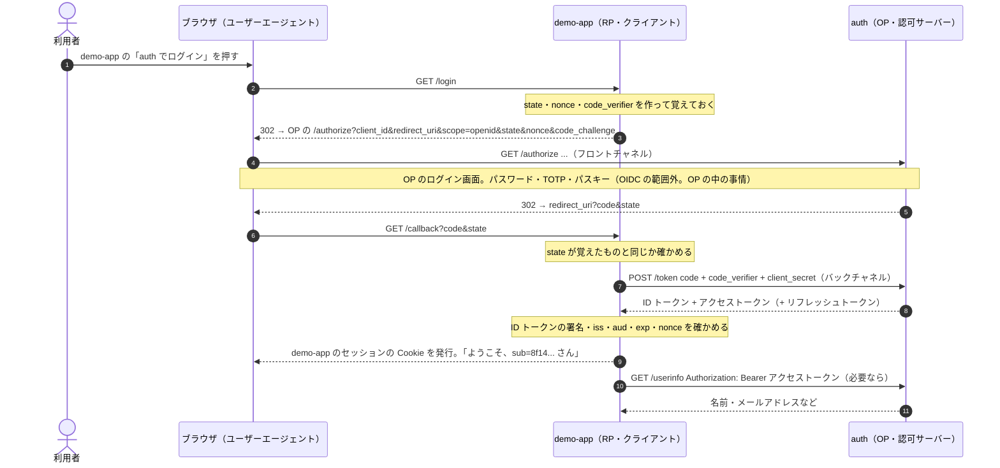

# 番外編：OAuth・OIDC の用語

最終更新：2026-11-07

OAuth 2.0 と OpenID Connect（OIDC）を実装する前に、出てくる用語を整理する。分野の全体像は [番外編：認証・認可の全体像](extra-auth-overview.md)。

用語が多く見えるが、実体はそれほど多くない。**同じものが、規格ごとに別の名前で呼ばれている**のが分かりにくさの大半を占めている。

## 1. 登場人物：同じものに名前がいくつもある

| 実体 | OAuth 2.0 での名前 | OIDC での名前 | SAML・一般での名前 | このリポジトリでは |
| --- | --- | --- | --- | --- |
| 利用者（人間） | リソースオーナー（Resource Owner） | エンドユーザー（End-User） | プリンシパル、サブジェクト | 自分 |
| 利用者が操作するブラウザ | ユーザーエージェント（User Agent） | 同じ | 同じ | ブラウザ |
| ログインさせたいアプリ | クライアント（Client） | RP（Relying Party：信頼する側） | SP（Service Provider） | demo-app |
| ログインを引き受け、トークンを出すサーバー | 認可サーバー（Authorization Server、AS） | OP（OpenID Provider） | IdP（Identity Provider） | auth |
| トークンを見て応じる API | リソースサーバー（Resource Server、RS） | （UserInfo エンドポイントがこれに当たる） | — | auth の `/userinfo` |

- **IdP・OP・認可サーバーは、このリポジトリでは全部 auth のこと**。言い方が違うのは、見ている面が違うから。「ログインした人が誰かを証明する」面を見れば IdP・OP、「トークンを発行して権限を渡す」面を見れば認可サーバー。
- **クライアント・RP・SP は、全部 demo-app のこと**。OIDC の RP は「OP の言うことを信頼（rely）する側」という意味で、まさに「IdP がログインしてよいと言っているから、うちにもログインさせよう」という立場。
- 「クライアント」はブラウザのことではない。OAuth の用語では、トークンを受け取って使う**アプリ**を指す。ブラウザはユーザーエージェント。最初に一番混乱しやすい点。

## 2. OAuth 2.0 と OIDC を一文で

| | 一文で | たとえ | 受け取るもの |
| --- | --- | --- | --- |
| OAuth 2.0 | アプリに、利用者の資源への**限られた権限**を渡す（認可） | ホテルのカードキー。フロント（認可サーバー）が発行し、決まった部屋（リソースサーバー）だけ開く。カードキーには、持っている人が誰かは書いていない | アクセストークン |
| OIDC | アプリに、**ログインしたのが誰か**を伝える（認証の結果の連携） | フロントが発行する、署名入りの「この人は 305 号室の○○様です」という証明書。宛先（どのアプリ向けか）と期限が書いてある | ID トークン |

- OIDC は OAuth 2.0 の流れをそのまま使い、最後に ID トークンを1枚足したもの。`scope` に `openid` を入れると OIDC になる。
- 自分のサービスの「auth でログイン」に必要なのは OIDC（誰か）。「Google カレンダーを読ませて」のように、アプリが利用者の代わりに API を叩くなら OAuth（権限）。実際は1回の流れで両方を受け取ることが多い。

## 3. トークンとコード

| 名前 | 誰が出す | 誰が受け取る | 誰が中身を読む | 寿命 | 何のため |
| --- | --- | --- | --- | --- | --- |
| 認可コード（authorization code） | 認可サーバー | クライアント（ブラウザを経由して届く） | 誰も読まない。ただの引換券 | 数十秒〜数分、1回だけ | トークンと交換する |
| ID トークン | OP | RP | **RP**（署名を検証し、中身を読む） | 数分〜1時間 | ログインしたのが誰かを RP に伝える |
| アクセストークン | 認可サーバー | クライアント | **リソースサーバー**（クライアントにとっては中身の分からない札） | 5分〜1時間 | API を叩く権限 |
| リフレッシュトークン | 認可サーバー | クライアント | 認可サーバーだけ | 数日〜数か月 | 利用者の操作なしに、新しいアクセストークンをもらう |

- **認可コードはブラウザを経由する**（URL に載る）ので、盗まれるかもしれない前提で作られている。だから1回限りで短命にし、交換には PKCE やクライアントの秘密を要求する。トークンそのものは、ブラウザを経由しない裏の通信で受け取る。
- **ID トークンは RP 宛て、アクセストークンは API 宛て**。ID トークンを API に送って「ログイン済みです」と言ったり、アクセストークンを持っていることを「ログインした証拠」として扱ったりするのは、どちらも典型的な誤用。
- **Bearer**（持参人）トークン：持っている人なら誰でも使えるトークン。HTTP では `Authorization: Bearer <トークン>` のヘッダーで送る。鍵というより、無記名の金券に近い。

## 4. JWT とその周辺

| 用語 | 意味 |
| --- | --- |
| JWT（JSON Web Token、「ジョット」） | JSON を署名して URL に載せられる文字列にしたもの。`ヘッダー.ペイロード.署名` を base64url でつなぐ。**暗号化ではない**。中身は誰でも読める。署名は「改ざんされていない」「誰が出したか」の証明 |
| クレーム（claim） | ペイロードに入っている1つ1つの項目。「主張」の意味 |
| JWS | JWT の署名の部分の規格。署名付きの JSON 一般 |
| JWK・JWKS | 公開鍵を JSON で表したもの（JWK）と、その一覧（JWK Set）。OP は `jwks_uri` で公開し、RP はそれで署名を検証する |
| `alg`・`kid` | ヘッダーの項目。署名の方式（ES256 など）と、どの鍵で署名したか |

ID トークンの中身の例（デコードしたもの）：

```json
{
  "iss": "https://auth.alphajinsei.com",
  "sub": "8f14e45f-...",
  "aud": "demo-app",
  "exp": 1762500000,
  "iat": 1762499700,
  "nonce": "n-0S6_WzA2Mj",
  "amr": ["pwd", "otp"]
}
```

| クレーム | 意味 | RP が確かめること |
| --- | --- | --- |
| `iss`（issuer） | 発行者 | 自分が信頼している OP か |
| `sub`（subject） | 利用者の ID。OP の中で一意で、変わらない | これを自分の DB の利用者と結び付ける（メールアドレスは変わりうるので使わない） |
| `aud`（audience） | 宛先。どの RP 向けか | 自分の `client_id` か。よそのアプリ向けのトークンを使い回させない |
| `exp`・`iat` | 期限・発行時刻 | 期限切れでないか |
| `nonce` | RP がフローの最初に作った乱数 | 自分が始めたフローの結果か（使い回しの防止） |
| `amr` | 使った認証の方式（パスワード、OTP、パスキーなど） | 必要なら「パスキーでログインした人だけ」のように使う |

## 5. 流れの用語

| 用語 | 意味 |
| --- | --- |
| エンドポイント | サーバーの決まった URL。OP の主なものは `/authorize`（ブラウザが来る入口）、`/token`（コードとトークンの交換）、`/userinfo`（利用者の情報を返す API）、`/jwks.json`（公開鍵） |
| Discovery | `/.well-known/openid-configuration`。上のエンドポイントの URL や対応する方式を一覧にした JSON。RP はこれ1つの URL だけ知っていればよい |
| `client_id`・`client_secret` | クライアントの ID とパスワード。OP に事前に登録しておく |
| コンフィデンシャルクライアント・パブリッククライアント | 秘密を安全に持てるか。サーバーで動く Web アプリは持てる（コンフィデンシャル）。SPA やスマホのアプリは中身を見られるので持てない（パブリック）。パブリッククライアントは PKCE で身を守る |
| `redirect_uri` | ログインが終わったあと、OP がブラウザを戻す先のクライアントの URL。事前に登録したものと完全一致でなければ拒む |
| フロントチャネル・バックチャネル | ブラウザのリダイレクトを経由する通信（URL に載る。利用者や拡張機能から見える）と、クライアントのサーバーから OP へ直接行く通信（見えない）。大事なもの（トークン）はバックチャネルで渡す |
| `scope` | 求める権限の範囲。OIDC の `openid`（ID トークンをください）、`profile`、`email` など。API ごとに `memos:read` のように自分で決めてもよい |
| 同意（consent） | 「demo-app があなたの〇〇を求めています。許可しますか」の画面。自分のサービス同士なら省くこともある |
| `state` | クライアントが作る乱数。戻ってきたときに、自分が始めたフローかを確かめる（CSRF の対策） |
| PKCE（「ピクシー」） | クライアントが乱数 `code_verifier` を作り、そのハッシュ `code_challenge` を最初に送る。コードを交換するときに元の乱数を出す。途中でコードを盗んだ人は、元の乱数を知らないので交換できない |
| グラント（grant）・フロー | トークンをもらう手順の種類。認可コード、クライアントクレデンシャル、デバイスコード、リフレッシュトークンなど |

## 6. 全体の流れ（認可コード + PKCE）



## 7. 混同しやすいもの

- **セッションは2つある。**OP（auth）のセッションと、RP（demo-app）のセッション。手順の途中で OP はログインした人に自分の Cookie を発行し、最後に demo-app も自分の Cookie を発行する。2つ目のアプリが「auth でログイン」したとき、OP のセッションが生きていればログイン画面を出さずにすぐ戻す。**これが SSO の正体**。ログアウトが難しいのも同じ理由で、RP からログアウトしても OP のセッションは残る。
- **認証と認可。**ID トークンで「誰か」が分かっても、「その人がこのメモを消してよいか」は demo-app が自分で決める（全体像の E）。OAuth の scope は「アプリに何を許したか」で、「利用者が何をしてよいか」とは別の軸。
- **OAuth は認証ではない。**アクセストークンを持っていることは、ログインした証拠にならない（別のアプリ向けに発行されたものを持ち込まれうる）。ログインには ID トークンの `aud` の確認が要る。これが OIDC が作られた理由。
- **JWT は暗号化ではない。**中身は誰でも読める。秘密を入れない。
