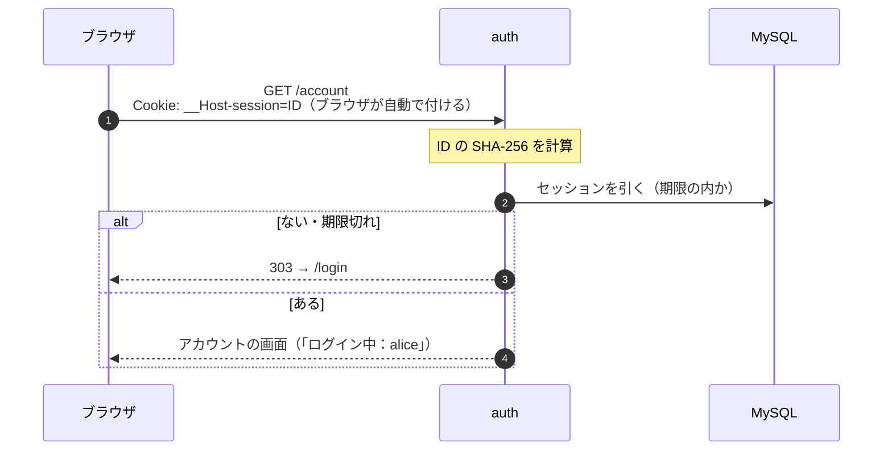

# 段1：パスワードでのログインとセッション

最終更新：2026-11-08

背景は [番外編：パスワードとセッションの来歴](../notes/extra-history-password-session.md)。この段で作るのは auth 単体のログインで、OIDC（ほかのアプリとの連携）はまだ出てこない。

## 1. 流れ

### ログイン

```mermaid
sequenceDiagram
  autonumber
  participant B as ブラウザ
  participant A as auth
  participant DB as MySQL

  B->>A: GET /login
  A-->>B: ログインのフォーム
  B->>A: POST /login（ユーザー名、パスワード）
  A->>DB: 利用者を引く（ハッシュ、失敗の回数、止めている期限）
  Note over A: 止めている期限の内なら、ここで断る
  Note over A: Argon2id で、入力をハッシュに照らす
  alt 合わない
    A->>DB: 失敗の回数を足す（5回で15分止める）
    A-->>B: フォームをもう一度（「ユーザー名かパスワードが違います」）
  else 合う
    A->>DB: 失敗の回数を0に戻す
    Note over A: セッション ID を乱数で作る（32バイト）
    A->>DB: セッションを記録（ID の SHA-256、利用者、期限）
    A-->>B: 303 → /account<br/>Set-Cookie: __Host-session=ID; HttpOnly; Secure; SameSite=Lax; Path=/
  end
```

- 5の「止めている期限の内なら断る」は、パスワードを照らす**前**に行う。止めている間は、正しいパスワードでも入れない（総当たりの途中で当たっても分からないように）。
- 合わないときのメッセージは、ユーザー名とパスワードのどちらが違うかを言わない。言うと、存在するユーザー名を探す手がかりになる。
- DB に置くのはセッション ID そのものではなく、その SHA-256。DB が漏れても、そのまま Cookie に入れては使えない（パスワードの「サーバーは秘密を持たない」と同じ考え方）。セッション ID は十分に長い乱数なので、パスワードと違い、遅いハッシュは要らない。

### 以後のリクエスト



### ログアウト

```mermaid
sequenceDiagram
  autonumber
  participant B as ブラウザ
  participant A as auth
  participant DB as MySQL

  B->>A: POST /logout（Cookie 付き）
  Note over A: Origin ヘッダーが自分か確かめる（CSRF の対策）
  A->>DB: セッションの行を消す
  A-->>B: 303 → /login<br/>Set-Cookie: __Host-session=; Max-Age=0
```

- ログアウトを GET にしない。GET だと、よそのサイトに `` を置くだけで、勝手にログアウトさせられる。状態を変える操作は POST にし、Origin を確かめる。
- 大事なのはサーバーの行を消すこと。Cookie を消すのは、ブラウザに後片付けを頼んでいるだけ（Cookie が残っていても、行がなければ無効）。

## 2. テーブル

| テーブル | 列 |
| --- | --- |
| `users` | `id`（UUID。OIDC の `sub` になる）、`username`、`password_hash`、`failed_count`、`locked_until`、`created_at` |
| `sessions` | `id_hash`（セッション ID の SHA-256）、`user_id`、`expires_at`、`created_at` |

## 3. 実装の小分け

| | 中身 | 読むもの |
| --- | --- | --- |
| 1-a | テンプレートのメモの API を取り除き、2つのテーブルを作る。管理用のコマンドで利用者を作る（Argon2id） | `schema.ts`、`admin.ts` |
| 1-b | ログイン・以後のリクエスト・ログアウト（上の図の3枚） | `routes/login.ts`、`session.ts` |
| 1-c | 失敗の回数による一時停止 | 1-b の差分 |
| 1-d | 共通基盤に初めて載せる | Terraform とデプロイのログ |

手元では `http://localhost:3000` で動かす。`Secure` の付いた Cookie は本来 HTTPS でしか送られないが、Chrome と Firefox は localhost を例外として扱うので、手元でもそのまま試せる。
