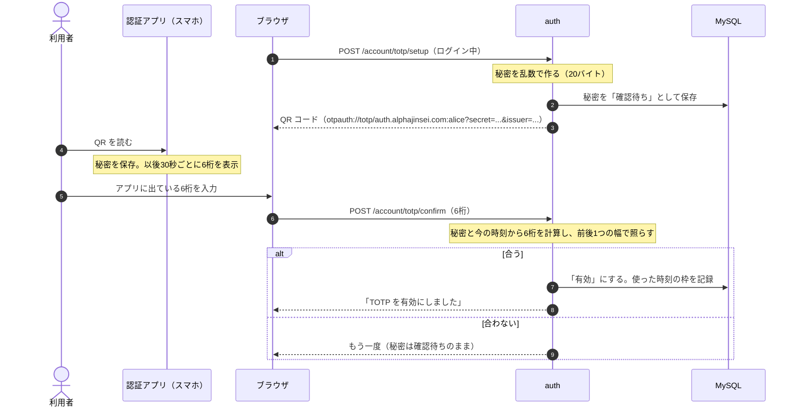
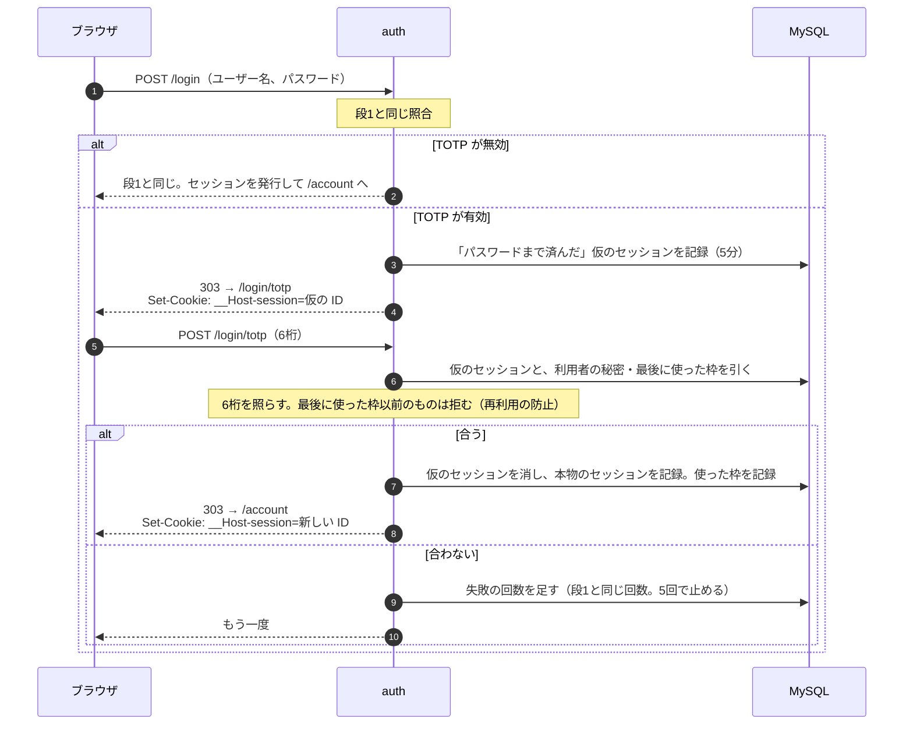

# 段2：TOTP

最終更新：2026-11-12

背景は [番外編：ワンタイムパスワードの来歴](../notes/extra-history-otp.md)。段1のパスワードでのログインに、2要素目として TOTP を足す。

## 1. 流れ

### 登録（ログインしたあと、アカウントの画面から）

- 確認の6桁を求めるのは、利用者がちゃんと読み取れたかを確かめるため。いきなり有効にすると、読み取りに失敗していた場合に、二度とログインできなくなる。
- QR の中身（秘密）が画面に出るのは、この1回だけ。

### ログイン（パスワードのあとに6桁）

- **仮のセッション**：パスワードまで済んだが、まだ6桁を入れていない状態。この ID では `/account` は開けない（`currentUser` は本物のセッションしか返さない）。
- 6桁が通ったら、**ID を作り直す**。段1のセッション固定の対策と同じで、権限が上がる瞬間に作り直す。
- 6桁は100万通りしかない。前後1つの幅を許すと、1回の試行で3つの値が当たりになる。回数制限がないと、総当たりで破れる。段1の失敗の回数を、パスワードと6桁の両方で数える。
- 同じ6桁は、30秒の間なら何度でも計算上は合う。最後に使った時刻の枠を記録し、それ以前の枠を拒む（RFC 6238 も、同じコードを2回受け付けてはならないと定めている）。

## 2. テーブル

| テーブル | 中身 |
| --- | --- |
| `totp_credentials`（新しく作る） | `user_id`、`secret`（暗号文）、`confirmed_at`（確認済みになった時刻。空なら確認待ち）、`last_step`（最後に使った時刻の枠） |
| `sessions`（列を足す） | `stage`（`password`：仮のセッション、`full`：本物のセッション）、`amr`（このセッションで使った認証の方式。`pwd`、`pwd otp` など） |

- TOTP を `users` の列にせず、別のテーブルにするのは、「アカウント」と「そのアカウントに登録した認証の手段」を分けておくため（段3のパスキーも同じ形の別テーブルになる）。どの方式でログインできるかは、アカウントの属性として持たず、**どの手段が登録されているか**から決まる。[設計](../design.md) の「認証の方式を選べるようにする」を参照。
- `amr`（Authentication Methods References）は、OIDC の ID トークンに入る項目と同じ名前・同じ値にしておく。段4で、RP に「この人はパスワード + TOTP でログインした」と伝えるのに、そのまま使える。

## 3. 決めたこと：秘密をどう保存するか

パスワードと違い、TOTP の秘密はハッシュにできない。照らすたびに、秘密そのものから6桁を計算するから（共有の秘密）。DB が漏れたら、全員分の2要素目が漏れる。

| 案 | 中身 | 手間 |
| --- | --- | --- |
| A. 平文で保存 | DB の列にそのまま | なし。DB が漏れたら、全員分が漏れる |
| B. 暗号化して保存 | AES-256-GCM で暗号化して保存する。鍵は Terraform で作って Vault に置き、デプロイのときにコンテナの環境変数に渡す（DB のパスワードと同じ経路） | Terraform に鍵を1つ足す。デプロイのスクリプトに1行足す |

B なら、DB だけが漏れても（バックアップの流出、SQL インジェクションなど）、鍵がなければ秘密は読めない。鍵と DB の両方を取られたら守れない点は同じ。

**B にした**（鍵は Vault のシークレット → デプロイのときに `.env` → コンテナの環境変数。Vault の鍵管理の機能で暗号化・復号する形は採らない）。経緯は [勉強メモ](../notes/study-notes.md) の「TOTP の秘密を暗号化して保存するとき、何がどこに置かれるのか」。

## 4. 実装の小分け

| | 中身 |
| --- | --- |
| 2-a | 6桁を作る計算（HMAC-SHA1 → 切り出し）と照合。RFC 6238 の付録のテスト値で確かめる |
| 2-b | 登録：アカウントの画面、QR、確認 |
| 2-c | ログイン：仮のセッション、6桁の画面、本物のセッションへの切り替え |
| 2-d | 秘密の暗号化と、鍵の用意（Terraform、デプロイのスクリプト） |
