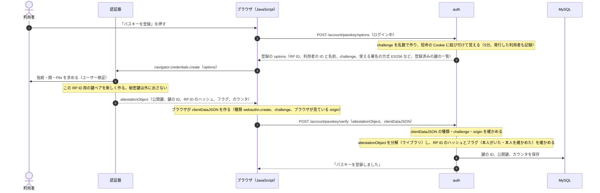
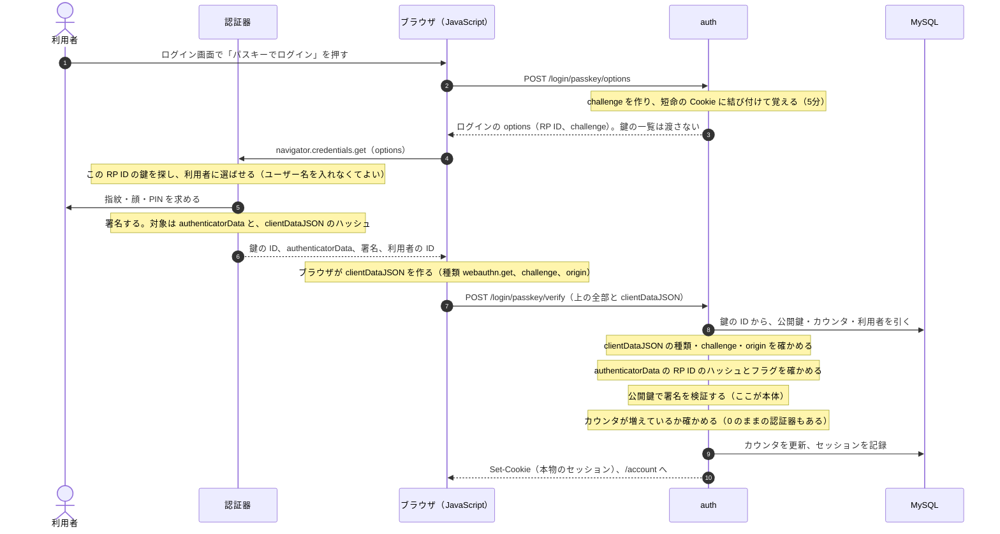

# 段3：パスキー

最終更新：2026-11-12

背景は [番外編：FIDO2 とパスキーの来歴](../notes/extra-history-fido.md)。ログインしたあと、アカウントの画面からパスキーを登録し、ログイン画面の「パスキーでログイン」で、パスワードなしでログインできるようにする。

## 1. 技術の要素：7つの組み合わせ

FIDO のシーケンスは、次の7つの要素の組み合わせで説明できる。どれも単独では昔からある考え方で、新しいのは組み合わせ方。

| # | 要素 | 何を保証するか | 由来 |
| --- | --- | --- | --- |
| ① | **公開鍵の署名** | 秘密鍵を持っていること（秘密を見せずに） | SSH、TLS のクライアント証明書 |
| ② | **challenge** | 署名が今回のための新しいもの（使い回しでない） | チャレンジ・レスポンス |
| ③ | **origin を署名に入れる** | どのサイトで操作したか（偽サイトの中継を見破る）。origin はブラウザが書き込むので、ページの JavaScript には偽れない | FIDO で新しく入った |
| ④ | **鍵をサイト（RP ID）ごとに分ける** | 偽サイトには本物の鍵を使わない。サイトをまたいで同一人物だと追跡されない | FIDO で新しく入った |
| ⑤ | **端末の中でのユーザー検証** | 鍵を使ったのが端末の持ち主本人（指紋・PIN）。生体情報はサーバーに送られない | スマホのロック解除 |
| ⑥ | **登録の信頼を、既存のログインから借りる** | 登録された公開鍵が本人のもの | `ssh-copy-id`、クラウドの鍵の登録 |
| ⑦ | **カウンタ** | 鍵が複製されていない（任意。同期されるパスキーでは 0） | ハードウェアトークン |

- **登録** ＝ ⑥ ログイン済みの画面から始める → ② challenge を渡す → ⑤ 本人を確かめて、④ この RP ID 用の鍵ペアを作る → ③ origin 入りの応答を返す → auth は ②③④ を確かめ、① の公開鍵を保存する
- **ログイン** ＝ ② challenge を渡す → ④ この RP ID の鍵を選び、⑤ 本人を確かめて、① 署名する（原文には ② と ③ が入っている）→ auth は ②③④ を確かめ、① を公開鍵で検証し、⑦ カウンタを見る

下の図の Note の「〜を確かめる」は、どれもこの番号のどれかに当たる。

**番号が2種類あるので注意**。この表の ①〜⑦ は**要素**の番号。下の図の丸数字は、Mermaid が矢印に振る**手順**の番号で、別物。コードのコメントでは、要素を「要素③」、手順を「登録 7」「ログイン 7」（どの図の何番の矢印か）と書き分ける。Note には番号がないので、「登録 7 のあとの 2つ目の Note」のように、直前の矢印で指す。

## 2. 登場人物

| 名前 | 何か | このリポジトリでは |
| --- | --- | --- |
| RP（Relying Party：信頼する側） | 誰かが出した認証の結果を信じて、利用者を受け入れる側。WebAuthn では「パスキーでログインさせるサイト」 | auth |
| RP サーバー | RP のうち、challenge を作り、署名を検証するところ。合否を決めるのはここだけ | auth のサーバー（`/…/passkey/options`、`/…/passkey/verify`） |
| RP アプリケーション | RP のうち、利用者が操作する画面と、その中で `navigator.credentials` を呼ぶ JavaScript | auth の画面の JavaScript |
| RP ID | 鍵を結び付けるドメイン。RP サーバーが決め、options で渡し、検証で確かめる。ブラウザは、RP ID が今のページのドメインと合っているかを確かめる | `auth.alphajinsei.com`（手元は `localhost`） |
| クライアント | WebAuthn の API を持つブラウザ（と OS） | ブラウザ |
| 認証器（authenticator） | 秘密鍵を持ち、署名する。指紋や PIN で本人を確かめる | スマホ、Mac の Touch ID、Windows Hello、セキュリティキー |
| challenge | サーバーが毎回作る乱数。署名に含めさせて、使い回しを防ぐ | 32バイト |

**RP は層によって違うものを指す。**auth は WebAuthn の層では RP で、OIDC の層（段4）では OP（IdP）。

| 層 | 証明を出す側 | 証明 | RP（それを信じる側） |
| --- | --- | --- | --- |
| WebAuthn（段3） | 認証器 | 署名（assertion） | auth |
| OIDC（段4） | auth（OP） | ID トークン | demo-app |

### 「WebAuthn を呼び出す」と origin

**WebAuthn を呼び出す**とは、ページの JavaScript が、ブラウザの API（`navigator.credentials.create()` / `get()`）を呼ぶこと。端末の中の関数の呼び出しで、ネットワークの通信ではない。その先で、ブラウザが認証器に鍵の作成や署名を頼む。

「呼び出す」と聞くと、クライアントからサーバーへの呼び出しを思い浮かべやすいが、そうではない。サーバー（auth）は、呼び出すコード（`public/passkey-register.js`）と材料（options）を配るだけで、呼ぶのはブラウザの中で動くそのコード。

| 言葉 | 何で決まるか | auth では |
| --- | --- | --- |
| **呼び出したページ** | `navigator.credentials` を呼んだ JavaScript を載せているページ（HTML） | `https://auth.alphajinsei.com/account` など、auth のページ |
| **origin** | そのページの URL（アドレスバー）のスキーム + ホスト + ポート。JS のファイルをどこから読み込んだかではない（CDN から読み込んだ JS でも、載せたページの origin になる） | `https://auth.alphajinsei.com` |
| **RP ID** | 既定では origin のドメイン。親のドメインまでは指定できる | `auth.alphajinsei.com` |

偽サイトは自分のページの URL を偽れないので、origin も偽れない。ブラウザが origin を clientDataJSON に書き込み、それが署名の対象に入る（要素③）。

「Google でログイン」に当てはめると、元のアプリのページは呼び出したページではない。リダイレクトで Google のログイン画面に移ってから、その画面の JavaScript が `navigator.credentials.get()` を呼ぶ。だから origin も RP ID も Google のもので、元のアプリのドメインはパスキーに一切登場しない。

```
1. app.example.com のページで「Google でログイン」を押す
2. リダイレクトで、ブラウザが accounts.google.com のページに移る（元のアプリのページは、もう画面にない）
3. accounts.google.com のページの JavaScript が navigator.credentials.get() を呼ぶ ← 呼び出したページ
   → ブラウザが origin = https://accounts.google.com を記録し、認証器が署名する
4. その署名を、Google のサーバーが検証する（RP サーバー）
5. リダイレクトで app.example.com に戻る（OIDC の層。段4）
```

### ブラウザを信じる範囲と、RP の分け方

ブラウザと認証器の間（CTAP、または OS の内部）は、サーバーからは見えない。サーバーがやりとりするのは、ブラウザの JavaScript だけ。

**ブラウザは信じる前提**。origin を正しく書くこと、RP ID がページのドメインと合うか確かめることは、ブラウザ（と OS）に任せている。攻撃者が自分で細工したブラウザを作っても、被害者の秘密鍵がないので署名できない。破れるのは被害者のブラウザ自体が乗っ取られたときだけで、それはパスワードでも Cookie でも守れない範囲として、FIDO の対象外にしている。サーバーは、署名・challenge・origin・RP ID のハッシュをすべて自分で確かめる。

RP サーバーと RP アプリケーションを別のサービスに分ける構成（検証専用の「FIDO サーバー」を置き、各アプリが API で呼ぶ）は企業でよく見かけるが、プロトコル上で必須なのは「challenge の発行と検証がサーバー側にあること」だけ。このリポジトリでは、段4で「パスキーを扱うのは IdP（auth）だけ。各アプリは OIDC で結果だけを受け取る」という分離を入れる。

## 3. 流れ

### 登録（ログインしたあと、アカウントの画面から）



- 登録の画面にログインしていることが前提。誰が自分のアカウントに鍵を足せるかを、既存のログイン（パスワード、TOTP）で守っている。
- attestation（認証器の製造元の証明）は求めない（`none`）。個人のサービスでは、どの認証器かを制限する理由がない。
- 「登録済みの鍵の一覧」を渡すのは、同じ認証器で二重に登録しないため（認証器が「もう登録済み」と断る）。

#### 図「登録」とコードの対応

| 手順 | 図の中身 | コード |
| --- | --- | --- |
| 登録 1 | 「パスキーを登録」を押す | [public/passkey-register.js](../../public/passkey-register.js) の `submit` |
| 登録 2 | POST /account/passkey/options | [src/routes/passkey.ts](../../src/routes/passkey.ts) の `POST /account/passkey/options`（ログイン中か＝要素⑥） |
| 登録 2 のあとの Note | challenge を作り、覚える | 同じファイルの `issueChallenge`、[src/webauthn.ts](../../src/webauthn.ts) の `newChallenge` |
| 登録 3 | options を返す | `src/webauthn.ts` の `registrationOptions` |
| 登録 4〜6 | 認証器が鍵ペアを作る | `public/passkey-register.js` の `navigator.credentials.create`。中身はブラウザと OS（コードはない） |
| 登録 6 のあとの Note | clientDataJSON を作る | ブラウザ。`public/passkey-register.js` の `credential.toJSON()` がまとめる |
| 登録 7 | POST /account/passkey/verify | `src/routes/passkey.ts` の `POST /account/passkey/verify`。最初に `takeChallenge`（取り出して消す） |
| 登録 7 のあとの 1つ目の Note | 種類・challenge・origin | `src/webauthn.ts` の `checkClientData`（要素②③） |
| 登録 7 のあとの 2つ目の Note | 分解、RP ID のハッシュとフラグ | `src/webauthn.ts` の `verifyRegistration` → `checkAuthData`（要素④⑤）、`coseToKey`（要素①） |
| 登録 8 | 鍵の ID、公開鍵、カウンタを保存 | `src/routes/passkey.ts` の `db.insert(webauthnCredentials)` |
| 登録 9 | 「パスキーを登録しました」 | `src/routes/passkey.ts` の `c.json({ ok: true })` → `public/passkey-register.js` が `/account?passkey=registered` へ |

### ログイン（パスワードなし）



- **origin の確認がフィッシングの対策そのもの**。偽サイトで操作すると、ブラウザが clientDataJSON に偽サイトの origin を入れる。それが署名の対象に入るので、中継されても、auth は「origin が違う」と拒む。
- **challenge の確認が使い回しの対策**。一度使った challenge は消すので、盗んだ署名をもう一度送っても通らない。
- **カウンタ**は、認証器が署名のたびに増やす数。保存した値より増えていなければ、鍵が複製された疑いがある。ただし、同期されるパスキーは、端末の間でカウンタを合わせられないので、常に 0 を返すものが多い。0 のときは確かめない。
- ユーザー検証（指紋・PIN）を済ませた鍵なので、パスキー1つで多要素になる。TOTP は求めない。
- 段2と同じく、利用者がいない鍵の ID、署名違い、などの理由は、画面には同じことしか出さず、監査ログにだけ残す。

#### 図「ログイン」とコードの対応

| 手順 | 図の中身 | コード |
| --- | --- | --- |
| ログイン 1 | 「パスキーでログイン」を押す | [public/passkey-login.js](../../public/passkey-login.js) の `click` |
| ログイン 2 | POST /login/passkey/options | [src/routes/passkey.ts](../../src/routes/passkey.ts) の `POST /login/passkey/options`（ログインしていなくてよい） |
| ログイン 2 のあとの Note | challenge を作り、短命の Cookie に結び付ける | 同じファイルの `issueChallenge`（利用者には結び付けない）、[src/webauthn.ts](../../src/webauthn.ts) の `newChallenge` |
| ログイン 3 | options を返す（鍵の一覧なし） | `src/webauthn.ts` の `authenticationOptions` |
| ログイン 4〜6 | 認証器が鍵を選ばせ、指紋・PIN のあとで署名する | `public/passkey-login.js` の `navigator.credentials.get`。中身はブラウザと OS |
| ログイン 6 のあとの Note | clientDataJSON を作る | ブラウザ。`credential.toJSON()` がまとめる |
| ログイン 7 | POST /login/passkey/verify | `src/routes/passkey.ts` の `POST /login/passkey/verify`。最初に `takeChallenge`（取り出して消す） |
| ログイン 8 | 鍵の ID から公開鍵・カウンタ・利用者を引く | 同じルートの `db.select(...).from(webauthnCredentials)` |
| ログイン 8 のあとの 1つ目の Note | 種類・challenge・origin | `src/webauthn.ts` の `verifyAuthentication` → `checkClientData`（要素②③） |
| ログイン 8 のあとの 2つ目の Note | RP ID のハッシュとフラグ | `verifyAuthentication` → `checkAuthData`（要素④⑤）。続けて user handle が鍵の持ち主か |
| ログイン 8 のあとの 3つ目の Note | 公開鍵で署名を検証する | `verifyAuthentication` の `coseToKey` と `crypto.verify`（要素①） |
| ログイン 8 のあとの 4つ目の Note | カウンタが増えているか | `verifyAuthentication` の最後（要素⑦） |
| ログイン 9 | カウンタを更新、セッションを記録 | `src/routes/passkey.ts` の `db.update(webauthnCredentials)` と `startSession(..., 'full', 'hwk' か 'swk')` |
| ログイン 10 | Set-Cookie、/account へ | `startSession` が Cookie を付け、`public/passkey-login.js` が `/account` へ移る |

**challenge と鍵の ID は、別々の役目で照らす。**サーバーは2つのものを引く。

- Cookie の引換券から引くのは「このブラウザに出した challenge」（ログイン 7 の `takeChallenge`）。
- 鍵の ID から引くのは、登録で預かった公開鍵（ログイン 8）。

そのうえで、届いた authenticatorData と clientDataJSON から署名の原文を組み立て、その公開鍵で検証する（3つ目の Note）。clientDataJSON の中の challenge は、1つ目の Note で、引いた challenge と比べてある。原文に challenge が入っているので、署名が正しければ「この鍵の持ち主が、今回の challenge に応えた」と言える。

- パスワードの失敗による一時停止（段1-c）は、パスキーのログインでは見ない。あれはパスワードの総当たりを遅くするためのもので、パスキーは総当たりできない。
- `amr` は、同期される鍵（authenticatorData の BE フラグが立つ）なら `swk`、端末に固定の鍵なら `hwk`（RFC 8176）。ユーザー検証（指紋・PIN）の分をどう表すかは 3-c で決める。

## 4. 自分で書くところ、ライブラリに任せるところ

| 処理 | 自分で書く | ライブラリ（`@simplewebauthn/server` の分解用の関数） |
| --- | --- | --- |
| challenge | 乱数で作る、覚える、一度使ったら消す | — |
| options | 組み立てる（RP ID、利用者、方式、ユーザー検証） | — |
| clientDataJSON | base64url を JSON に戻し、種類・challenge・origin を確かめる | — |
| attestationObject | — | CBOR を分解する（`decodeAttestationObject`） |
| authenticatorData | RP ID のハッシュ、フラグ、カウンタを確かめる | バイト列を分解する（`parseAuthenticatorData`） |
| 公開鍵 | COSE の形から、Node.js の鍵（JWK）に直す | COSE を分解する（`decodeCredentialPublicKey`） |
| 署名の検証 | `authenticatorData ‖ SHA-256(clientDataJSON)` を、公開鍵で `crypto.verify` する | — |

ブラウザ側は、`PublicKeyCredential.parseCreationOptionsFromJSON()` と `credential.toJSON()` を使う（主要なブラウザが対応済み）。サーバーとやりとりする JSON とバイト列の変換を、ブラウザが引き受けてくれる。

## 5. テーブル

| テーブル | 中身 |
| --- | --- |
| `webauthn_credentials`（新しく作る） | `id`（鍵の ID。認証器が作る）、`user_id`、`public_key`（COSE の形のまま）、`sign_count`、`name`（「iPhone」などの表示用）、`created_at`、`last_used_at` |
| `webauthn_challenges`（新しく作る） | `id_hash`（Cookie に入れる乱数の SHA-256）、`challenge`、`purpose`（register / login）、`user_id`（登録のときだけ）、`expires_at` |
| `users`（変える） | `password_hash` を空にできるようにする（パスキーだけのアカウントのため。3-c） |

- 利用者の ID（user handle）には、`users.id`（UUID）を使う。認証器に保存され、ログインのときに返ってくる。名前やメールアドレスのような個人情報を入れないのが決まり。
- 1人で複数の鍵を登録できる（スマホ、パソコン、セキュリティキー）。

## 6. 実装の小分け

| | 中身 |
| --- | --- |
| 3-a | 登録：options、ブラウザの JavaScript、検証、保存。アカウントの画面に「パスキーを登録」と一覧 |
| 3-b | ログイン：options、ブラウザの JavaScript、署名の検証、セッション。ログイン画面に「パスキーでログイン」 |
| 3-c | パスキーだけのアカウント（パスワードを空にできる）、パスキーの削除、`amr` の値、本番で試す |

手元では `http://localhost:3001` で試す。WebAuthn は HTTPS が必須だが、localhost だけは例外として HTTP でも使える。RP ID は `localhost`。
