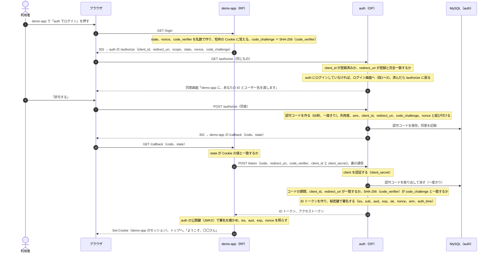
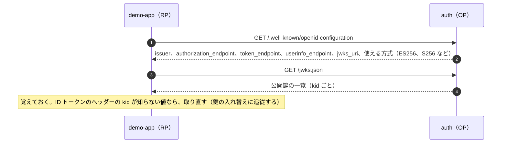
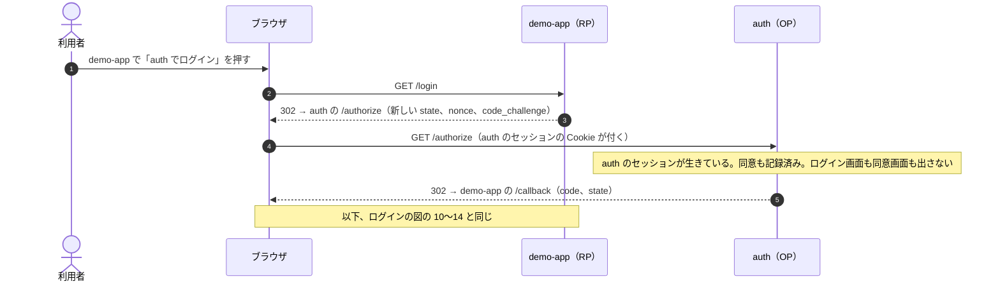
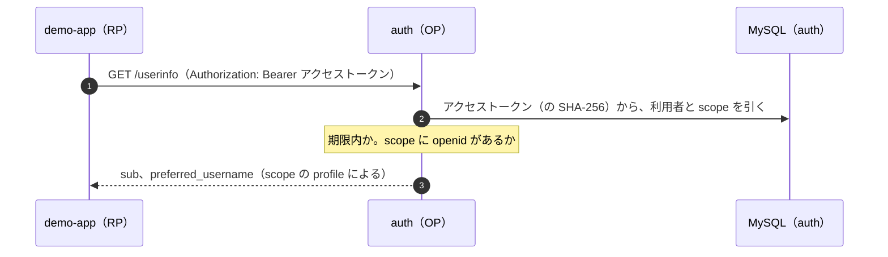

# 段4：OIDC（認可コード + PKCE）

最終更新：2026-11-15

背景は [番外編：OAuth 2.0 と OpenID Connect の来歴](../notes/extra-history-oauth-oidc.md)、用語は [番外編：OAuth・OIDC の用語](../notes/extra-auth-terms.md)。demo-app の「auth でログイン」を押すと auth に移り、段1〜3のどれかでログインし、demo-app に戻ってくると、demo-app が「誰がログインしたか」を知っている、までを作る。

## この文書の読み方

| 節 | 中身 |
| --- | --- |
| 1. 技術の要素 | 認可コード + PKCE を、9つの要素に分ける。以下の節は、この番号で読む |
| 2. 登場人物 | 用語の表 |
| 3. 仕組みの補足 | 表だけでは分かりにくいところ（ブラウザが運び役になる、2つのセッション、state と PKCE と nonce の違い） |
| 4. 流れ | 誰が何を作るかの文章と、シーケンス図（ログイン、準備、2つ目以降のログイン） |
| 5. 実装 | 決めること、テーブル、小分け |

**番号が2種類ある**のは段3と同じ。1 の表の ①〜⑨ は**要素**の番号、4 の図の丸数字は**手順**（矢印）の番号。コードのコメントでは「要素③」「ログイン 7」「ログイン 7 のあとの Note」と書き分ける。

## 1. 技術の要素：9つの組み合わせ

| # | 要素 | 何を保証するか | 由来 |
| --- | --- | --- | --- |
| ① | **リダイレクトで、ブラウザを運び役にする** | demo-app と auth が直接つながっていなくても（demo-app が手元の localhost でも）、利用者のブラウザが要求と応答を運ぶ | SAML、OpenID 2.0 |
| ② | **redirect_uri の事前登録と完全一致** | auth が結果を返す先は、demo-app が登録した URL だけ。偽サイトが「結果をこちらへ」と頼めない | OAuth 2.0（Security BCP で完全一致に） |
| ③ | **同意** | 利用者が、demo-app に何を渡すか（scope）を自分で許す | OAuth 1.0 |
| ④ | **認可コード** | ブラウザが運ぶのは、短命・一度きりの引換券だけ。トークンそのものは URL に載らない（履歴やリファラーから漏れない） | OAuth 2.0 |
| ⑤ | **裏の通信で引き換える（client の認証付き）** | コードをトークンに引き換えられるのは、client_secret を持つ demo-app のサーバーだけ | OAuth 2.0 |
| ⑥ | **PKCE** | コードを横取りされても、最初に乱数を作った本人（demo-app）でなければ引き換えられない | RFC 7636（2015年） |
| ⑦ | **state** | 戻ってきた応答が、自分（このブラウザの demo-app）が始めた要求への応答か（ログインの CSRF の対策） | OAuth 2.0 |
| ⑧ | **ID トークン（署名、iss・aud・exp）** | 誰がログインしたかを、auth が署名して demo-app 宛てに書いたもの。宛先が違えば拒む（すり替えの対策） | SAML のアサーション、JWT |
| ⑨ | **nonce** | ID トークンが、今回の要求のために作られたもの（使い回しでない） | OIDC |

- **ログイン** ＝ demo-app が ⑥⑦⑨ の乱数を作る → ① ブラウザを auth へ送る → auth は ② を確かめ、利用者にログインさせ、③ 同意をもらう → ④ コードを ① で demo-app へ返す → demo-app は ⑦ を確かめ、⑤ 裏の通信で ⑥ の乱数と一緒にコードを引き換える → auth は ②④⑤⑥ を確かめ、⑧⑨ の ID トークンに署名して返す → demo-app は ⑧⑨ を確かめる

段3のパスキーと同じ骨格がある。⑨ の nonce は段3の challenge、⑧ の aud は段3の RP ID、⑧ の署名は段3の署名に当たる。違うのは、**署名する側が利用者の認証器ではなく auth** で、**検証する側が auth ではなく demo-app** なこと（RP が層によって違う、の OIDC の層）。

## 2. 登場人物

| 名前 | 何か | このリポジトリでは |
| --- | --- | --- |
| OP（OpenID Provider）＝ 認可サーバー | ログインさせ、ID トークンとアクセストークンを出す側 | auth（`https://auth.alphajinsei.com`、手元は `http://localhost:3001`） |
| RP（Relying Party）＝ client | OP の ID トークンを信じて、利用者をログインさせる側 | demo-app（`http://localhost:4000`） |
| issuer | OP の識別子（URL）。ID トークンの `iss` に入り、RP はこれが期待どおりか確かめる | auth の origin |
| client_id、client_secret | RP の名前と、RP のサーバーだけが持つ合言葉。auth に事前に登録する | `demo-app` と、登録のときに一度だけ表示する乱数 |
| redirect_uri | auth が結果（認可コード）を返す先。事前に登録した値と完全一致させる | `http://localhost:4000/callback` |
| scope | RP が求めるもの。`openid` があれば OIDC の要求 | `openid profile`（ID と、ユーザー名） |
| 認可コード | ブラウザが運ぶ引換券。60秒、一度きり | 32バイトの乱数 |
| ID トークン | 誰が、いつ、どうやってログインしたか。auth が署名した JWT | ES256 で署名 |
| アクセストークン | `/userinfo` を呼べる許可証（段5で本格的に使う） | 段4は乱数（DB で引く）。段5で JWT にするか決める |
| JWKS | auth の公開鍵の一覧。RP は ID トークンの署名をこれで確かめる | `/jwks.json` |
| Discovery | auth の設定（各 URL、使える方式）の一覧 | `/.well-known/openid-configuration` |

## 3. 仕組みの補足

### client の事前登録

auth は demo-app のことを事前に知っておく必要がある。登録するのは、client_id（どのアプリか。同意画面に出す名前）、redirect_uri（結果を返す先）、client_secret（裏の通信で demo-app だと確かめる合言葉）。一番大事なのは redirect_uri で、登録がないと、攻撃者が redirect_uri に自分のサイトを書いた要求に利用者を送り込み、利用者が正規に同意した認可コードを受け取れてしまう。

登録のしかたは IdP によって違う。Google は開発者が Cloud Console で自分で登録する（重い scope は審査あり）。企業の IdP は管理者が登録する。API で自動登録する仕組み（Dynamic Client Registration、RFC 7591）もある。このリポジトリは管理用のコマンドで登録する。

### ブラウザが運び役になる（表の通信と裏の通信）

通信には2種類ある。

| | 表の通信（front channel） | 裏の通信（back channel） |
| --- | --- | --- |
| 経路 | ブラウザのリダイレクト。demo-app → ブラウザ → auth → ブラウザ → demo-app | demo-app のサーバーから auth へ、直接の HTTPS |
| 運ぶもの | 要求（client_id、redirect_uri、state など）と、認可コード | 認可コードと client_secret と code_verifier を送り、トークンを受け取る |
| 見える人 | 利用者、ブラウザの履歴、拡張機能、（スマホなら）ほかのアプリ | demo-app と auth だけ |
| 図では | ログイン 3〜4、9〜10 | ログイン 11〜13 |

**大事なものは裏で渡す**のが、認可コードの流れの考え方。理由は2つある。表の通信は漏れやすい（URL は履歴、Referer、アクセスログ、拡張機能、スマホではほかのアプリに残る）。そして表の通信では、auth は「この URL へ行け」と言うだけで、行った先で誰が受け取ったかを確かめられない。裏の通信なら、client_secret で相手を確かめてから渡せる。

認可コードは「同意した」という証明ではなく、**`/authorize` で決まったこと全部（誰が、どうやってログインしたか、どの client、redirect_uri、同意した scope、code_challenge、nonce）を指す引換券**。何を許すかは表で全部決まっていて、品物（トークン）は裏で引き換える。クロークの番号札と同じ。URL に直接トークンを載せる方式（implicit）もあったが、漏れやすいので今は使わない。

表を通るのは、盗まれても単独では使えないもの（短命・一度きりのコード）だけにする。手元では demo-app が localhost にあり、auth から demo-app へは直接つながれないが、表の通信は利用者のブラウザが運ぶので問題ない。裏の通信は demo-app から auth へ向かうだけなので、これも成り立つ。

### 2つのセッション

ログインが終わると、Cookie が2つできる。

| Cookie | 誰のもの | 意味 |
| --- | --- | --- |
| auth のセッション（`__Host-session`） | auth | 「この利用者は auth にログイン済み」。段1〜3のもの |
| demo-app のセッション | demo-app | 「この利用者は demo-app にログイン済み」。ID トークンを確かめたあとに demo-app が作る |

2つ目のアプリが「auth でログイン」したとき、auth のセッションが生きていれば、ログイン画面を出さずにすぐ戻す。**これが SSO の正体**（4 の「2つ目以降のログイン」の図）。逆に、demo-app からログアウトしても auth のセッションは残る（ログアウトの連携は [設計](../design.md) の「今後の発展」）。

手元では、auth（`localhost:3001`）と demo-app（`localhost:4000`）が同じホスト名になる。**Cookie はポートで分かれない**ので、2つのアプリの Cookie は同じ名前にしない（demo-app は `__Host-demo-session` にする）。本番ではドメインが分かれるので、この心配はない。

### state、PKCE、nonce の違い

3つとも「RP が最初に乱数を作り、あとで照らす」もので、似ている。守るものが違う。

| | 作る人 | どこに入れて送るか | どこで照らすか | 防ぐ攻撃 |
| --- | --- | --- | --- | --- |
| ⑦ state | demo-app | `/authorize` の URL。そのまま戻ってくる | demo-app（ログイン 10 のあとの Note） | 攻撃者が自分のコードを被害者のブラウザに踏ませ、被害者を**攻撃者のアカウント**でログインさせる（ログインの CSRF） |
| ⑥ PKCE | demo-app | `/authorize` に code_challenge（ハッシュ）、`/token` に code_verifier（元の乱数） | auth（ログイン 12 のあとの 1つ目の Note） | 認可コードの横取り。コードだけでは引き換えられない |
| ⑨ nonce | demo-app | `/authorize` の URL。auth が ID トークンの中に入れる | demo-app（ログイン 13 のあとの Note） | ID トークンの使い回し、別の要求への差し替え |

PKCE は state の役も果たせる（攻撃者のコードは、被害者のブラウザの code_verifier と合わない）ので、最近の指針（RFC 9700）では、PKCE があれば state は必須ではないとされる。このリポジトリでは、学ぶために3つとも入れる。

### client_secret と PKCE を両方使う理由

PKCE は、もとは client_secret を安全に持てないアプリ（スマホのアプリ、ブラウザだけのアプリ）のための仕組みだった。demo-app はサーバーを持つので client_secret を持てる（**confidential client**）。それでも RFC 9700 は、confidential client にも PKCE を勧めている。client_secret は「引き換えに来たのが demo-app か」、PKCE は「引き換えに来たのが、このコードの要求を始めた demo-app のこのセッションか」を確かめるもので、守るものが違うため。

## 4. 流れ

### 全体：誰が何を作り、何を渡すか

1. **demo-app** が乱数を3つ作る（state、nonce、code_verifier）。code_verifier のハッシュ（code_challenge）も作る。3つの元の値は、短命の Cookie に入れて覚える。
2. **demo-app** が、ブラウザを auth の `/authorize` へリダイレクトさせる。URL に client_id、redirect_uri、scope、state、nonce、code_challenge を載せる。
3. **auth** が client_id と redirect_uri を登録と照らす。利用者が auth にログインしていなければ、ログイン画面（段1〜3）を挟む。同意がまだなら、同意画面を出す。
4. **auth** が認可コードを作り、そのコードに「誰が、どうやってログインしたか（amr）、どの client に、どの redirect_uri で、code_challenge、nonce」を結び付けて DB に置く。ブラウザを redirect_uri へ、コードと state を付けてリダイレクトさせる。
5. **demo-app** が、戻ってきた state を Cookie の値と照らす。
6. **demo-app** のサーバーが、auth の `/token` に直接、コード、redirect_uri、code_verifier、client_id と client_secret を送る。
7. **auth** が client を認証し、コードを取り出して消し（一度きり）、redirect_uri と、`SHA-256(code_verifier)` が code_challenge と一致するかを確かめる。ID トークン（iss、sub、aud、exp、iat、nonce、amr、auth_time）を作って秘密鍵で署名し、アクセストークンと一緒に返す。
8. **demo-app** が、auth の公開鍵（JWKS）で ID トークンの署名を確かめ、iss、aud、exp、nonce を照らす。通れば、sub を「ログインした人」として、自分のセッションを作る。

### ログイン（認可コード + PKCE）

- **redirect_uri の完全一致**（ログイン 4 のあとの 1つ目の Note）。前方一致や、ワイルドカードを許すと、`https://demo.example.com/callback/../evil` のような抜け道で、コードを別の場所に送らせられる。登録した文字列と、1文字残らず同じであることを求める。
- **redirect_uri を `/token` でもう一度送る**のは、コードを出したときの redirect_uri と同じかを auth が確かめるため（コードを別の client の流れに持ち込ませない）。
- **同意は記録する**。同じ利用者・同じ client・同じ scope なら、次からは同意画面を出さない（「2つ目以降のログイン」）。
- **ID トークンの amr** には、段1〜3で記録したセッションの amr（`pwd`、`pwd otp mfa`、`hwk mfa` など）をそのまま入れる。demo-app は、パスキーに一切触れずに「多要素でログインした」と分かる。
- 断るときの扱い。redirect_uri が登録と違う、client_id が不明、のときは、**redirect_uri へ戻さず**、auth の画面にエラーを出す（偽の redirect_uri にエラーを送ると、それ自体が攻撃の足がかりになる）。それ以外（利用者が同意を断った、など）は、redirect_uri に `error=access_denied` と state を付けて戻す。

### 準備：Discovery と JWKS（demo-app が起動するとき）

- demo-app に渡す設定は、auth の URL（issuer）と、client_id、client_secret の3つだけ。各 URL は Discovery から読む。
- 公開鍵は秘密ではないので、誰でも取れる。署名に使う秘密鍵は auth だけが持つ（Vault に置く。5 の「決めること」）。

### 2つ目以降のログイン（SSO）

利用者から見ると、「auth でログイン」を押した瞬間に、demo-app にログインした状態で戻ってくる。auth の画面は一瞬も見えない。

### /userinfo（アクセストークンで呼ぶ API）

段4では、アクセストークンを「DB で引く乱数」にする（セッション ID と同じ形）。段5で、JWT にして API が自分で検証する形（DB を引かない）と比べる。

## 5. 実装

### 決めること

| 項目 | 案 | 理由 |
| --- | --- | --- |
| ID トークンの署名の方式 | ES256（P-256） | 段3で検証した方式と同じ。鍵も署名も短い |
| 署名の秘密鍵の置き場所 | Terraform で作って Vault に置き、デプロイで環境変数に渡す（TOTP の鍵と同じ） | 段2で決めた形をそのまま使う。鍵の入れ替えは、JWKS に新旧の両方を載せれば止めずにできる（今回は作らない） |
| JWT の作り方 | 自分で書く（ヘッダー・中身の base64url、`crypto.sign`） | 段3で署名の検証を書いたので、作る側も小さい。ライブラリ（`jose`）は使わない |
| client の登録 | 管理用のコマンド（`admin create-client demo-app http://localhost:4000/callback`）。client_secret は一度だけ表示し、DB にはハッシュを置く | 利用者と同じ方針。登録の画面は作らない |
| demo-app の RP の実装 | 段4では、検証を自分で書く（Discovery、JWKS、署名、iss・aud・exp・nonce） | RP が何を確かめるかを見るため。段5で独立したリポジトリ（ひな形）にするとき、ライブラリ（`openid-client`）に置き換えるかを決める |
| demo-app の置き場所 | このリポジトリの `demo-app/`（別の Hono のアプリ、ポート 4000、DB なし） | 段5で独立させるまでの仮住まい |
| 同意画面 | 作る。記録して、2回目からは出さない | 自分のアプリ同士なら省けるが、学ぶために作る |

### テーブル

| テーブル | 中身 |
| --- | --- |
| `oauth_clients` | `id`（client_id）、`secret_hash`（client_secret の SHA-256）、`name`（同意画面に出す名前）、`redirect_uris`（登録した URL。完全一致で照らす）、`created_at` |
| `authorization_codes` | `code_hash`（SHA-256）、`client_id`、`user_id`、`redirect_uri`、`scope`、`code_challenge`、`nonce`、`amr`、`auth_time`、`expires_at`（60秒） |
| `oauth_consents` | `user_id`、`client_id`、`scope`、`created_at` |
| `access_tokens` | `token_hash`（SHA-256）、`client_id`、`user_id`、`scope`、`expires_at`（段4。段5で見直す） |

- client_secret はセッション ID と同じく十分長い乱数なので、遅いハッシュ（Argon2id）は要らない。SHA-256 で足りる。
- `auth_time` は、利用者が auth で実際にログインした時刻（セッションを作った時刻）。SSO で2回目に来たときは、新しいログインではないので、最初の時刻のまま入る。

### 実装の小分け

| | 中身 |
| --- | --- |
| 4-a | 署名の鍵（Vault）、JWT を作る関数、`/jwks.json`、`/.well-known/openid-configuration` |
| 4-b | client の登録（管理用のコマンド）、`/authorize`（照合、ログイン画面への寄り道と戻り、同意画面）、認可コード |
| 4-c | `/token`（client の認証、コード、PKCE、ID トークン、アクセストークン）、`/userinfo` |
| 4-d | demo-app（`/login`、`/callback`、検証、セッション、トップの画面に ID トークンの中身）。手元で通しで試す |
| 4-e | 本番に載せ、手元の demo-app から本番の auth でログインする（demo-app は localhost のまま） |
