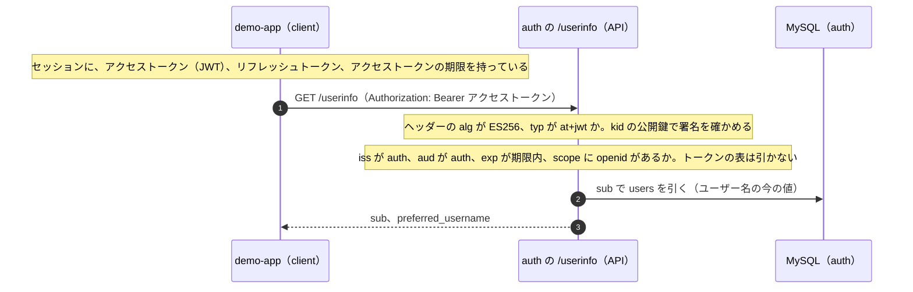
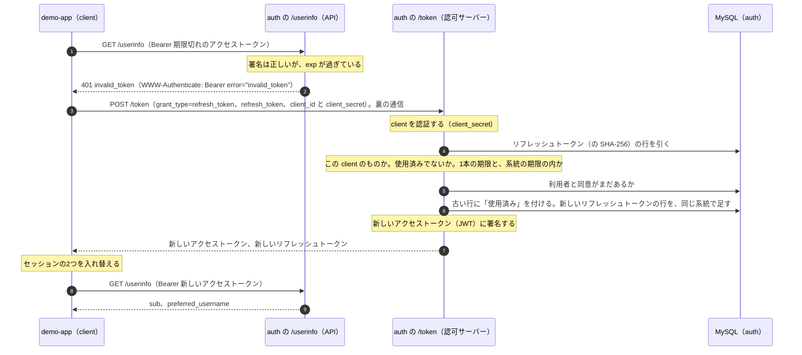
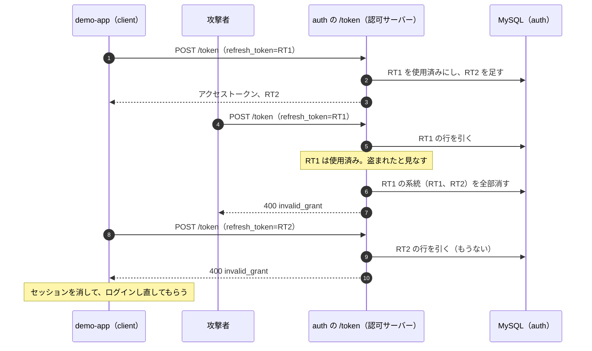
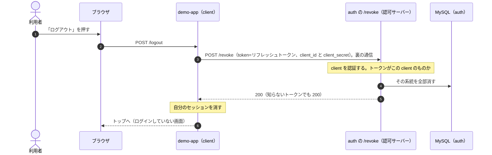

# ステップ5：アクセストークンとリフレッシュトークン

最終更新：2026-11-18

背景は [番外編：アクセストークンとリフレッシュトークンの来歴](../notes/extra-history-tokens.md)。ステップ4では、アクセストークンを「DB を引く乱数」にし、期限（1時間）が切れたらログインし直すしかなかった。このステップでは、来歴の 10 節の「今の形」を小さく作る。

- アクセストークンを JWT（RFC 9068 の形）にし、`/userinfo` が DB を引かずに確かめる
- リフレッシュトークンを出し、期限が切れたアクセストークンを、ログインし直さずに出し直す
- リフレッシュトークンを使うたびに取り替え、使用済みのものが来たら盗難と見なして系統ごと取り消す
- demo-app のログアウトで、リフレッシュトークンを取り消す

ロードマップのステップ5のうち、残りの2つ（demo-app を独立したリポジトリにする、認可モデル）は、この文書のあとの節として、あとで足す。

## この文書の読み方

| 節 | 中身 |
| --- | --- |
| 1. 技術の要素 | アクセストークンとリフレッシュトークンを、8つの要素に分ける。以下の節は、この番号で読む |
| 2. 登場人物 | 用語の表。ステップ4からの変化 |
| 3. 仕組みの補足 | 表だけでは分かりにくいところ（opaque と JWT の比べ方、系統と2つの期限、取り消しが効く範囲） |
| 4. 流れ | シーケンス図（API を呼ぶ、期限切れとリフレッシュ、盗難の検知、ログアウトと取り消し） |
| 5. 実装 | 決めること、テーブル、小分け |

番号の書き分けはステップ4と同じ。1 の表の ①〜⑧ は**要素**、4 の図の番号は**手順**（矢印）。コードのコメントでは「要素③」「リフレッシュ 5」「リフレッシュ 5 のあとの Note」と書く。図とコードの対応の表は、実装のあとに足す。

## 1. 技術の要素：8つの組み合わせ

| # | 要素 | 何を保証するか | 由来 |
| --- | --- | --- | --- |
| ① | **短命のアクセストークン** | 盗まれても、使えるのは期限（5分）まで。取り消しの確認を省ける代わりの歯止め | OAuth WRAP（2009年） |
| ② | **値の形（JWT、`typ: at+jwt`）** | 誰の、どの client の、どの scope の、いつまでの許可かを、auth が書いて署名する。`typ` で ID トークンと取り違えさせない | JWT（RFC 7519）、RFC 9068（2021年） |
| ③ | **API が手元で確かめる** | `/userinfo` は、署名（JWKS と同じ鍵）、iss、aud、exp、scope を計算だけで確かめる。トークンの表を引かない | RFC 9068 の 4 節 |
| ④ | **リフレッシュトークン（opaque、認可サーバーにだけ見せる）** | 長生きの許可は、auth の `/token` にだけ、client の認証付きで出す。API には一度も見せない | OAuth WRAP、RFC 6749 の 6 節 |
| ⑤ | **使うたびの判断のし直し** | リフレッシュのたびに、auth が記録を引いて、取り消されていないか、利用者と同意がまだあるかを確かめる | RFC 6749 の 6 節 |
| ⑥ | **取り替え（rotation）** | リフレッシュのたびに新しいリフレッシュトークンを出し、使ったものは使用済みにする | RFC 9700（2025年、BCP 240） |
| ⑦ | **使用済みの検知（系統ごとの取り消し）** | 使用済みのリフレッシュトークンが来たら、盗まれたと見なし、同じログインから続く系統を全部取り消す | RFC 9700 の 4.14.2 |
| ⑧ | **取り消しの口（`/revoke`）** | ログアウトのときに、client が「このリフレッシュトークンを無効にして」と頼める | RFC 7009（2013年） |

- **API を呼ぶ** ＝ demo-app が ② をヘッダーに付ける → auth の `/userinfo` が ③ で確かめる（① の期限内なら通る）
- **リフレッシュ** ＝ ① が切れた → demo-app が ④ を client の認証付きで `/token` へ → auth が ⑤ で判断し直し、⑥ で取り替えて、新しい ② と ④ を返す
- **盗難** ＝ 使用済みの ④ が来た → ⑦ で系統ごと取り消す
- **ログアウト** ＝ demo-app が ⑧ で ④ を取り消す。② は期限まで残る（① の短さで補う）

ステップ4の要素と比べると、⑥⑦ は認可コードの「一度きりで、異常に気づける」（ステップ4の要素④）を、長生きのトークンに広げたもの。③ は demo-app が ID トークンを確かめた手順（ステップ4の要素⑧）を、API の側でやるもの。

## 2. 登場人物

| 名前 | 何か | このリポジトリでは |
| --- | --- | --- |
| 認可サーバー（OP） | トークンを出し、リフレッシュと取り消しを受ける | auth の `/token`、`/revoke` |
| API（リソースサーバー） | アクセストークンを受けて、利用者のデータを返す | auth の `/userinfo`。同じ auth の中にあるが、このステップでは「auth の DB のトークンの表を見ない、別の API」のつもりで書く |
| client | トークンを受け取り、API を呼ぶ | demo-app（client_secret を持つ、confidential client） |
| アクセストークン | API を呼ぶ許可証 | ステップ4：32バイトの乱数、DB に SHA-256、1時間 → ステップ5：JWT（ES256、`typ: at+jwt`）、DB に置かない、5分 |
| リフレッシュトークン | アクセストークンを出し直す券 | 32バイトの乱数、DB に SHA-256。1本の期限 14日、系統の期限 30日 |
| 系統（family） | 1回のログイン（認可コードの引き換え）から、取り替えで続くリフレッシュトークンの並び | `family_id`（乱数）でまとめる |
| aud（アクセストークンの） | どの API 宛てか | auth の issuer（`https://auth.alphajinsei.com`）。API が auth の中にしかないので。ID トークンの aud（client_id）とは違う値になる |

## 3. 仕組みの補足

### opaque と JWT を、どう比べるか

ステップ4の opaque のアクセストークンを、ステップ5で JWT に替える。比べるのは、`/userinfo` が要求を受けたときに何をするか。

| | ステップ4（opaque） | ステップ5（JWT） |
| --- | --- | --- |
| トークンを確かめる | `access_tokens` を SHA-256 で引く | 署名、iss、aud、exp、scope を計算で確かめる。表を引かない |
| 利用者のデータを返す | `users` を結合して引く | `users` を sub で引く（ユーザー名は今の値を返したいので、ここは DB を引く） |
| 取り消し | 行を消せば、次の要求から効く | 効かない。期限（5分）まで通る |
| DB が落ちたら | トークンを確かめられない | トークンは確かめられる（データは返せない） |

`/userinfo` は利用者のデータを返す API なので、結局 `users` は引く。違いが出るのは「トークンを確かめる」の行だけ。API がトークンの確認のためだけに DB を引く必要がなくなる、というのが JWT の得で、データを持たない API（たとえば、scope だけ見て計算する API）なら、DB にまったく触れずに済む。

### 系統と、2つの期限

リフレッシュトークンには、期限を2つ持たせる（来歴の記事の勉強メモ「リフレッシュトークンもアクセストークンと同じ周期になるのか」）。

| 期限 | 数え始め | 取り替えで | 意味 |
| --- | --- | --- | --- |
| 1本の期限（14日） | そのリフレッシュトークンを出したとき | 新しいものは、そこから数え直す | 14日使わなければ、ログインし直し |
| 系統の期限（30日） | 最初のログイン（認可コードの引き換え） | 延びない | 使い続けていても、30日でログインし直し |

新しいリフレッシュトークンの期限は、「今から14日」と「系統の期限」の早いほう。

### 使用済みの行を残す理由

取り替えたあと、古いリフレッシュトークンの行を消すと、次に古いものが来たときに「知らないトークン」になり、盗難と区別できない。そこで、古い行は「使用済み」（`used_at`）の印を付けて残し、系統の期限が来たら掃除する。

- 知らないトークン：`invalid_grant` で断るだけ
- 使用済みのトークン：盗難と見なし、系統を全部消してから `invalid_grant`

### 取り消しが効く範囲

| 取り消す操作 | リフレッシュトークン | すでに出たアクセストークン（JWT） |
| --- | --- | --- |
| demo-app のログアウト（`/revoke`） | 系統ごと、すぐ効く | 期限（5分）まで通る |
| 盗難の検知 | 系統ごと、すぐ効く | 期限まで通る |
| 利用者が同意を取り消す（今は画面がない） | 次のリフレッシュで断られる | 期限まで通る |

アクセストークンを5分にしたのは、この「期限まで通る」の幅を小さくするため。demo-app の画面で期限切れとリフレッシュを確かめやすい長さでもある。

### 同時に2回リフレッシュしたら

demo-app が同じリフレッシュトークンで、ほぼ同時に2回リフレッシュすると、2回目は「使用済み」になり、盗難と見なして系統を消してしまう（正しい持ち主なのに、ログインし直しになる）。製品によっては、使用済みでも数秒以内なら許す猶予を設ける。今回は猶予を作らず、demo-app の側で同時に2回リフレッシュしない作りにする。

## 4. 流れ

### API を呼ぶ（アクセストークンが期限内）

ステップ4の図「/userinfo」との違いは、2 のあとの2つの Note（DB を引かずに確かめる）と、3 で引くのが `users` だけになったこと。

### 期限切れとリフレッシュ

auth は1つのプログラムだが、ここでは2つの役で出てくる。`/userinfo` は **API（リソースサーバー）**としての auth で、アクセストークンを受ける。`/token` は**認可サーバー**としての auth で、リフレッシュトークンを受ける。図では2本の線に分ける。API がよそのサーバーにあっても、流れは同じ（1〜2 と 8〜9 の宛先が、そのサーバーになるだけ）。

- demo-app は、401 を受けてからリフレッシュする（図の流れ）。手元の期限（`expires_in` から計算）を見て、切れる前にリフレッシュする作りもあり、無駄な 401 が減る。demo-app は、期限切れの 401 を画面で見られるように、401 を受けてからにする。
- リフレッシュの返事に、ID トークンは入れない（OIDC Core 12.2 では入れてもよい）。demo-app が「誰か」を知るのはログインのときだけで十分なので。
- 4 のあとの Note か 5 のどれかが外れたら `invalid_grant`。demo-app は自分のセッションを消して、ログインし直してもらう。

### 盗難の検知

攻撃者が、何かの方法でリフレッシュトークン RT1 と client_secret を手に入れたとする（client_secret がなければ、そもそも使えない。要素④）。

順番が逆（攻撃者が先に RT1 を使い、demo-app があとで RT1 を使う）でも、あとから来た方が「使用済み」を出すので、同じように系統が消える。どちらが盗んだ側かは auth には分からないので、両方を締め出す。正しい利用者はログインし直せばよく、攻撃者はログインできない。

### ログアウトと取り消し

- `/revoke` は、知らないトークン（すでに消えた、期限切れ）でも 200 を返す（RFC 7009 の 2.2）。client がすることは「捨てた」で同じなので、エラーにしない。
- すでに出たアクセストークンは、期限（5分）まで `/userinfo` を通る。demo-app はセッションごと捨てるので、手元に残らない。
- auth のセッション（ブラウザの Cookie）は、ステップ4と同じく残る。もう一度「auth でログイン」を押すと、auth の画面を通らずに戻ってくる。

## 5. 実装

### 決めること

| 項目 | 案 | 理由 |
| --- | --- | --- |
| アクセストークンの形 | JWT（RFC 9068）。ヘッダーは `alg: ES256`、`typ: at+jwt`、`kid`。中身は iss、sub、aud、client_id、scope、iat、exp、jti | 来歴の 6 節。`typ` を ID トークン（`JWT`）と分け、`/userinfo` は `at+jwt` 以外を断る |
| 署名の鍵 | ID トークンと同じ鍵（Vault の `OIDC_SIGNING_KEY`） | 鍵を増やさない。`typ` と aud で取り違えを防ぐ |
| aud | auth の issuer | API は auth の中の `/userinfo` だけ。API が増えたら、API ごとの識別子にする（RFC 8707 の resource） |
| アクセストークンの期限 | 5分 | 取り消しが効かない幅を小さくする。demo-app で期限切れを確かめやすい |
| `access_tokens` の表 | 消す（マイグレーション） | JWT にすると使わない。opaque の形は、ステップ4の文書とこの文書の 3 節に残す |
| リフレッシュトークンの形 | 32バイトの乱数。DB に SHA-256 | auth しか読まないので、中身を書く必要がない（来歴の 11 節） |
| リフレッシュトークンを出す相手 | client_secret を持つ client に、ログインのたびに | 今の client はすべて confidential。OIDC の `offline_access`（利用者がいないときも使う許可）の scope は作らない |
| 期限 | 1本 14日、系統 30日 | 3 節「系統と、2つの期限」 |
| 盗難の検知 | 使用済みが来たら、系統ごと消す。猶予は作らない | 3 節「同時に2回リフレッシュしたら」 |
| リフレッシュの返事 | アクセストークン、リフレッシュトークン、`expires_in`、scope。ID トークンは入れない | 4 節の図「期限切れとリフレッシュ」の下 |
| `/revoke` | リフレッシュトークンだけを受ける。系統ごと消す。知らないトークンでも 200 | アクセストークンは JWT で、取り消しても `/userinfo` は記録を見ないので意味がない |
| Discovery | `grant_types_supported` に `refresh_token`、`revocation_endpoint` を足す | client が口を見つけられるように |
| demo-app | セッションにトークンを持つ。トップに「/userinfo を呼ぶ」ボタン、アクセストークンの中身と期限。401 ならリフレッシュして1回だけやり直す。ログアウトで `/revoke` | 期限切れ、リフレッシュ、取り替えを画面で見られるように |

### テーブル

| テーブル | 中身 |
| --- | --- |
| `refresh_tokens`（足す） | `token_hash`（SHA-256、主キー）、`family_id`、`client_id`、`user_id`、`scope`、`expires_at`（1本の期限）、`family_expires_at`（系統の期限）、`used_at`（使用済みなら時刻）、`created_at` |
| `access_tokens`（消す） | ステップ4の opaque のアクセストークン |

- `family_id` に索引を張る（系統ごと消すため）。
- 掃除：`family_expires_at` を過ぎた行を、`/token` のたびに消す（ステップ4の認可コードと同じ形）。

### 実装の小分け

| | 中身 |
| --- | --- |
| 5-a | アクセストークンを JWT に（`signJwt` に `typ` を渡せるように）、`/userinfo` が手元で確かめる、`access_tokens` を消す |
| 5-b | `refresh_tokens`、ログインでリフレッシュトークンを出す、`grant_type=refresh_token`（取り替え、使用済みの検知）、Discovery |
| 5-c | `/revoke` |
| 5-d | demo-app：トークンをセッションに、「/userinfo を呼ぶ」、401 でリフレッシュ、ログアウトで `/revoke`。手元で通しで試す（期限切れ、盗難の検知も） |
| 5-e | 本番に載せる（マイグレーションが流れる。鍵や共通基盤は変えない） |
