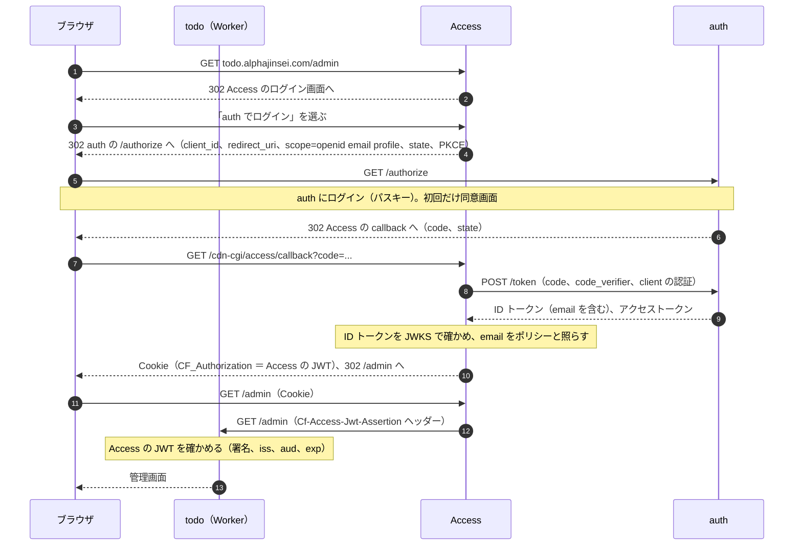

# ステップ9：Cloudflare Access を RP にする（todo のログイン）

最終更新：2026-11-20

これまで auth の RP（「auth でログイン」する側）は、自分で書いた demo-app と sample-auth-client だけだった。このステップでは、**他人が書いた RP**として Cloudflare Access をつなぐ。todo（`todo.alphajinsei.com/admin`）は Access で守っていて、今のログインはメールのワンタイムコードだけ。ここに「auth でログイン（パスキー）」を足す。

新しい技術ではない（ステップ4・5の OIDC そのもの）ので、来歴の記事は書かない。学ぶことは2つ。

- **自分で書いていない RP に合わせる**：Access が何を求め、何を送ってくるかを、ドキュメントと実際の通信から確かめる。足りないもの（email のクレーム、client の認証の方式）を auth に足す。
- **認証の結果を、もう一段渡す**：auth の ID トークンを受け取るのは Access で、todo の Worker が受け取るのは Access の JWT。OIDC の RP が、受け取った結果を自分の形に詰め直して、さらに後ろへ渡す（ゲートウェイ型の RP）。

## 1. 登場人物

| 名前 | 役 | ここでは |
| --- | --- | --- |
| ブラウザ | 利用者 | 自分 |
| todo（Worker） | 守られるアプリ。Access の JWT を確かめる | `todo.alphajinsei.com` |
| Access | todo の前に立つ門番。auth から見ると **RP**（client） | `alphajinsei.cloudflareaccess.com` |
| auth | **OP**。パスキーなどで本人を確かめ、ID トークンを出す | `auth.alphajinsei.com` |

auth から見ると、client が1つ増えるだけ。client_id は `cloudflare-access`、redirect_uri は `https://alphajinsei.cloudflareaccess.com/cdn-cgi/access/callback`。

## 2. 流れ

- 4〜9 が、ステップ4の図「ログイン」と同じ形。違うのは、RP が demo-app ではなく Access であること。
- 10〜13 は、todo の公開のときに作った部分（[todo の勉強メモ](https://github.com/alphajinsei/todo/blob/main/docs/notes/study-notes.md)）。todo は auth のことを何も知らない。auth の ID トークンは Access の中で使い終わり、todo に届くのは Access が出し直した JWT だけ。
- 9 のあとの Note：Access は ID トークンの `email` を見て、「このアドレスなら通す」というポリシーと照らす。auth は email を出していないので、ここで足す。

## 3. Access について分かっていること

[Cloudflare のドキュメント（Generic OIDC）](https://developers.cloudflare.com/cloudflare-one/integrations/identity-providers/generic-oidc/) から。

| 項目 | ドキュメント | auth の今 | すること |
| --- | --- | --- | --- |
| 設定する URL | `auth_url`、`token_url`、`certs_url` を手で書く（Discovery は人が読んで写す） | Discovery あり | なし |
| 署名のアルゴリズム | RS256・ES256 などに対応 | ES256 | なし |
| PKCE | `pkce_enabled` で、すべてのログインで行う（方式は書いていない） | S256 必須 | 有効にする。S256 でなければ 5 で止まるので分かる |
| scope | `scopes` で指定（例は `openid email profile`） | `openid profile` だけ。知らない scope は黙って外す | `email` を足す |
| email | ID トークンの `email` クレームで利用者を見分ける（名前は `email_claim_name` で変えられる） | 出していない | 足す |
| client の認証 | **書いていない**（Basic ヘッダーか、本文か） | `client_secret_basic` だけ | `client_secret_post` も受ける。→ 実際は `client_secret_basic` だった（9-e の監査ログ）。post は、他の RP のために残す |
| state、nonce | 書いていない | state 必須、nonce は来たら返す | なし。state を送ってこなければ 5 で止まるので分かる |
| `email_verified` | 見るかどうか書いていない | 出していない | 出す |

## 4. 決めること

- **email の持ち方**：`users` に `email` の列を足す（空でもよい、重複は不可）。設定は管理用のコマンド（`admin set-email <username> <email>`）。利用者の登録の画面がないのと同じ理由で、画面は作らない。
- **`email_verified`**：`true` にする。アドレスを入れるのは管理者（自分）だけで、利用者が自分で書き込む口がないため。登録の画面を作ってアドレスを利用者が書くようになったら、確認のメールを送るまでは `false`。
  - これを確かめないまま `true` にする IdP は危ない。RP が email で利用者を見分けていると、他人のアドレスを書いた人が、その人になりすませる。
- **`email` scope**：OIDC Core 5.4 のとおり、`email` scope があるときだけ `email` と `email_verified` を入れる（ID トークンと `/userinfo` の両方）。
- **client の認証**：`client_secret_post`（本文に `client_id` と `client_secret`）も受ける。両方の方式を同時に使ってきたら断る（RFC 6749 2.3：1つの要求で2つ以上の方式を使ってはいけない）。Discovery の `token_endpoint_auth_methods_supported` にも足す。どちらで来たかは監査ログに出し、Access がどちらを使うかを確かめる。
- **IdP と client_secret の置き場所**：auth の Terraform（`infra/terraform/access-idp.tf`）。IdP は Cloudflare のアカウントに1つで、Access のどのアプリからも選べる auth の窓口なので、todo ではなく auth で持つ。secret は `random_password` で作って Vault に置き、Access の IdP の設定にも入れる。auth への登録は `npm run register-access-client`（app VM の上で Vault から読み、`admin create-client --secret-stdin` に流し込む。sample-auth-client と同じ経路）。Access の設定は、DNS 用とは別の Cloudflare のトークンで変える（`tf.sh` が渡す）。
  - 経緯：最初は todo の Terraform に置き、secret は Vault を通さず ssh で流し込んだ。動いたあとで、置き場所が違うと気づいて移した（todo は `removed` で state から外し、auth は `import` で取り込む。IdP は作り直さない）。
- **ワンタイムコードは残す**：auth が落ちたときに todo を編集できなくならないように、両方を選べるようにする。

## 5. 小分け

| | 中身 | 場所 | 誰が |
| --- | --- | --- | --- |
| 9-a | `users.email`、`set-email`、`email` scope、ID トークンと `/userinfo` の `email`・`email_verified`、Discovery | auth | Claude（手元で試す） |
| 9-b | `/token` と `/revoke` で `client_secret_post` も受ける | auth | Claude（手元で試す） |
| 9-c | 本番に載せる（マイグレーション、デプロイ）、自分のアカウントに email を入れる | auth | ユーザーがコマンドを実行 |
| 9-d | Terraform に IdP（OIDC、PKCE）と secret を足す。auth に client を登録する（のちに todo から auth の Terraform へ移した） | auth | Claude が書き、ユーザーが apply と登録を実行 |
| 9-e | todo の `/admin` に、auth のパスキーでログインする。Access の「Test」でも確かめる | — | ユーザー |
